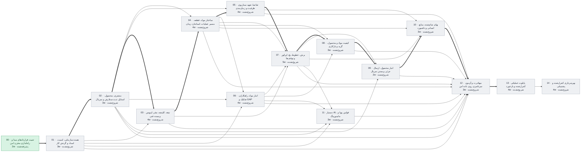

# وضعیت پروژه عالیخان — ۱۳ آبان ۱۴۰۵

> تاریخ‌ها برآورد برنامه‌ریزی‌اند، نه تعهد. با هر گام قبول‌شده، ضریب سرعت واقعی جایگزین فرض می‌شود.

## خلاصه

- **فاز فعال:** ندارد — قابل شروع: PHASE_01
- **گام جاری:** —
- **پیشرفت:** 8/120 گام قبول‌شده
- **آماده تست شما:** 0 مورد
- **تصمیم P0 باز (کل پروژه):** 17
- **شروع پایلوت (PHASE_13):** خوش‌بینانه ۲۱ دی ۱۴۰۵ · مبنا **۱۶ بهمن ۱۴۰۵** · بدبینانه ۹ فروردین ۱۴۰۶
- **مسیر بحرانی:** 00 → 01 → 02 → 03 → 04 → 05 → 07 → 08 → 09 → 10 → 12 → 13 — تا شروع پایلوت 36 هفته برآوردی

## آماده تست

هنوز چیزی برای تست عملیاتی آماده نیست.

## منتظر تصمیم شما (افق فعلی)

| شناسه | اولویت | موضوع | مالک | وضعیت |
|---|---|---|---|---|
| DEC-027 | P1 | صفحات ۱ و ۲ HTML مستقل ندارند؛ scope approval و Design System | کارفرما + UI Lead | OPEN |
| DEC-032 | P1 | الگوی maker-checker و دوره نگهداری Audit | IT + کارفرما | PROPOSED |

## گراف وابستگی فازها

## جدول فازها

| فاز | عنوان | وابستگی | وضعیت | گام قبول | برآورد (هفته) | شروع | پایان (مبنا) |
|---|---|---|---|---|---|---|---|
| PHASE_00 | تثبیت قراردادهای مبنا و راه‌اندازی مخزن امن | — | پذیرفته‌شده | 8/8 | 2 | ۱۴۰۵/۰۸/۱۲ | ۱۴۰۵/۰۸/۱۳ |
| PHASE_01 | هسته سازمانی، امنیت، اسناد و گردش کار | 00 | شروع‌نشده | 0/8 | 3 | ۱۴۰۵/۰۸/۱۳ | ۱۴۰۵/۰۸/۲۱ |
| PHASE_02 | مشتری، محصول، استایل، ثبت سفارش و سریال | 01 | شروع‌نشده | 0/8 | 3 | ۱۴۰۵/۰۸/۲۱ | ۱۴۰۵/۰۸/۲۹ |
| PHASE_03 | تیغه، کلیشه، مقر، لیویس و بسته فنی | 01, 02 | شروع‌نشده | 0/8 | 4 | ۱۴۰۵/۰۸/۲۹ | ۱۴۰۵/۰۹/۱۰ |
| PHASE_04 | ساختار مواد، قطعه، مسیر عملیات، استاندارد زمان | 02, 03 | شروع‌نشده | 0/8 | 4 | ۱۴۰۵/۰۹/۱۰ | ۱۴۰۵/۰۹/۲۱ |
| PHASE_05 | تقاضا، تعهد، سناریوی ظرفیت و زمان‌بندی | 02, 04 | شروع‌نشده | 0/8 | 4 | ۱۴۰۵/۰۹/۲۱ | ۱۴۰۵/۱۰/۰۲ |
| PHASE_06 | انبار مواد، راهکاران، تفکیک و GAP | 01, 02, 04 | شروع‌نشده | 0/8 | 4 | ۱۴۰۵/۰۹/۲۱ | ۱۴۰۵/۱۰/۰۲ |
| PHASE_07 | برش، خطوط، بچ، اپراتور و توقف‌ها | 03, 04, 05, 06 | شروع‌نشده | 0/8 | 5 | ۱۴۰۵/۱۰/۰۲ | ۱۴۰۵/۱۰/۱۶ |
| PHASE_08 | کیفیت مواد و محصول، گرید و بازکاری | 04, 06, 07 | شروع‌نشده | 0/8 | 3 | ۱۴۰۵/۱۰/۱۶ | ۱۴۰۵/۱۰/۲۴ |
| PHASE_09 | انبار محصول، ارسال جزئی و بستن سریال | 02, 07, 08 | شروع‌نشده | 0/8 | 2 | ۱۴۰۵/۱۰/۲۴ | ۱۴۰۵/۱۰/۳۰ |
| PHASE_10 | بهای تمام‌شده، منابع انسانی و داشبورد | 04, 05, 07, 09 | شروع‌نشده | 0/8 | 3 | ۱۴۰۵/۱۰/۳۰ | ۱۴۰۵/۱۱/۰۸ |
| PHASE_11 | دستیار AI، قوانین پویا و مانیتورینگ | 01, 02, 06, 07 | شروع‌نشده | 0/8 | 3 | ۱۴۰۵/۱۰/۱۶ | ۱۴۰۵/۱۰/۲۴ |
| PHASE_12 | مهاجرت و آزمون سرتاسری روی داده امن | 01, 02, 03, 04, 05, 06, 07, 08, 09, 10, 11 | شروع‌نشده | 0/8 | 3 | ۱۴۰۵/۱۱/۰۸ | ۱۴۰۵/۱۱/۱۶ |
| PHASE_13 | پایلوت عملیاتی کنترل‌شده و بازخورد | 12 | شروع‌نشده | 0/8 | 4 | ۱۴۰۵/۱۱/۱۶ | ۱۴۰۵/۱۱/۲۷ |
| PHASE_14 | بهره‌برداری کنترل‌شده و پشتیبانی | 13 | شروع‌نشده | 0/8 | 4 | ۱۴۰۵/۱۱/۲۷ | ۱۴۰۵/۱۲/۰۸ |

## آخرین رویدادها

- `2026-11-04T14:41:21+00:00` gate phase=PHASE_00 verdict=ACCEPTED by=بسام ربیهاوی note=همه بندهای Gate بسته شد
- `2026-11-04T12:36:27+00:00` decision id=DEC-047 status=APPROVED by=بسام ربیهاوی (کارفرما) note=Gate-0: حالت همه دسترسی‌ها بسته (deny-all) پذیرفته شد؛ ماتریس نقش‌ها و DEC-032 در گام ۰۱.۱ همراه کاربران/نقش‌ها/نمودار سازمانی (DEC-003، DEC-043) نهایی و تأیید می‌شود.
- `2026-11-04T12:36:27+00:00` decision_added id=DEC-047 status=OPEN
- `2026-11-04T11:34:20+00:00` step phase=PHASE_00 step=00.8 state=PASS
- `2026-11-04T11:34:20+00:00` gate_pending phase=PHASE_00
- `2026-11-04T11:26:09+00:00` step phase=PHASE_00 step=00.8 state=IN_REVIEW commit=3c0ea1c03e0582d4a5e0d3e5e0fa76e151a659ed
- `2026-11-04T11:00:30+00:00` step phase=PHASE_00 step=00.8 state=IN_PROGRESS
- `2026-11-04T09:26:55+00:00` step phase=PHASE_00 step=00.7 state=PASS
- `2026-11-04T09:26:55+00:00` step phase=PHASE_00 step=00.7 state=IN_REVIEW commit=d6b6de96784d8d4d715e5978a2552c3531798faa
- `2026-11-04T09:26:54+00:00` step phase=PHASE_00 step=00.7 state=IN_PROGRESS
- `2026-11-04T09:24:54+00:00` decision id=DEC-046 status=APPROVED by=کارفرما note=مخزن GitHub عمومی بماند (اصلاح DEC-041 فقط در نمایانی). قواعد DEC-041 پابرجاست: هیچ داده خصوصی کارخانه، رمز یا داده مشتری در مخزن. پیامد پذیرفته‌شده: کد، handoff، گزارش‌ها، وضعیت و ایمیل commitها برای همه قابل خواندن است؛ اسکن راز در CI گیت است.
- `2026-11-04T09:24:54+00:00` decision_added id=DEC-046 status=OPEN
- `2026-11-04T09:18:54+00:00` step phase=PHASE_00 step=00.7 state=BLOCKED
- `2026-11-04T07:14:01+00:00` step phase=PHASE_00 step=00.7 state=IN_REVIEW commit=d6b6de96784d8d4d715e5978a2552c3531798faa
- `2026-11-04T05:58:10+00:00` step phase=PHASE_00 step=00.7 state=IN_PROGRESS
