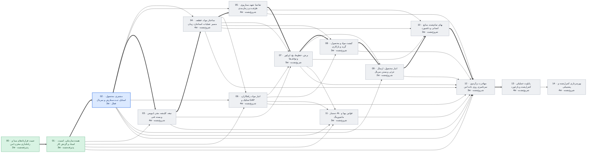

# وضعیت پروژه عالیخان — ۲۳ آبان ۱۴۰۵

> تاریخ‌ها برآورد برنامه‌ریزی‌اند، نه تعهد. با هر گام قبول‌شده، ضریب سرعت واقعی جایگزین فرض می‌شود.

## خلاصه

- **فاز فعال:** PHASE_02 مشتری، محصول، استایل، ثبت سفارش و سریال (فعال)
- **گام جاری:** 02.4 Backend/API (اصلاح)
- **پیشرفت:** 19/120 گام قبول‌شده
- **آماده تست شما:** 0 مورد
- **تصمیم P0 باز (کل پروژه):** 15
- **شروع پایلوت (PHASE_13):** خوش‌بینانه ۲۳ دی ۱۴۰۵ · مبنا **۱۵ بهمن ۱۴۰۵** · بدبینانه ۱ فروردین ۱۴۰۶
- **مسیر بحرانی:** 00 → 01 → 02 → 03 → 04 → 05 → 07 → 08 → 09 → 10 → 12 → 13 — تا شروع پایلوت 36 هفته برآوردی

## آماده تست

هنوز چیزی برای تست عملیاتی آماده نیست.

## منتظر تصمیم شما (افق فعلی)

تصمیم بازی در افق فعلی نیست.

## گراف وابستگی فازها

## جدول فازها

| فاز | عنوان | وابستگی | وضعیت | گام قبول | برآورد (هفته) | شروع | پایان (مبنا) |
|---|---|---|---|---|---|---|---|
| PHASE_00 | تثبیت قراردادهای مبنا و راه‌اندازی مخزن امن | — | پذیرفته‌شده | 8/8 | 2 | ۱۴۰۵/۰۸/۱۲ | ۱۴۰۵/۰۸/۱۳ |
| PHASE_01 | هسته سازمانی، امنیت، اسناد و گردش کار | 00 | پذیرفته‌شده | 8/8 | 3 | ۱۴۰۵/۰۸/۱۳ | ۱۴۰۵/۰۸/۲۰ |
| PHASE_02 | مشتری، محصول، استایل، ثبت سفارش و سریال | 01 | فعال | 3/8 | 3 | ۱۴۰۵/۰۸/۲۰ | ۱۴۰۵/۰۸/۲۸ |
| PHASE_03 | تیغه، کلیشه، مقر، لیویس و بسته فنی | 01, 02 | شروع‌نشده | 0/8 | 4 | ۱۴۰۵/۰۸/۲۸ | ۱۴۰۵/۰۹/۰۹ |
| PHASE_04 | ساختار مواد، قطعه، مسیر عملیات، استاندارد زمان | 02, 03 | شروع‌نشده | 0/8 | 4 | ۱۴۰۵/۰۹/۰۹ | ۱۴۰۵/۰۹/۲۰ |
| PHASE_05 | تقاضا، تعهد، سناریوی ظرفیت و زمان‌بندی | 02, 04 | شروع‌نشده | 0/8 | 4 | ۱۴۰۵/۰۹/۲۰ | ۱۴۰۵/۱۰/۰۱ |
| PHASE_06 | انبار مواد، راهکاران، تفکیک و GAP | 01, 02, 04 | شروع‌نشده | 0/8 | 4 | ۱۴۰۵/۰۹/۲۰ | ۱۴۰۵/۱۰/۰۱ |
| PHASE_07 | برش، خطوط، بچ، اپراتور و توقف‌ها | 03, 04, 05, 06 | شروع‌نشده | 0/8 | 5 | ۱۴۰۵/۱۰/۰۱ | ۱۴۰۵/۱۰/۱۵ |
| PHASE_08 | کیفیت مواد و محصول، گرید و بازکاری | 04, 06, 07 | شروع‌نشده | 0/8 | 3 | ۱۴۰۵/۱۰/۱۵ | ۱۴۰۵/۱۰/۲۳ |
| PHASE_09 | انبار محصول، ارسال جزئی و بستن سریال | 02, 07, 08 | شروع‌نشده | 0/8 | 2 | ۱۴۰۵/۱۰/۲۳ | ۱۴۰۵/۱۰/۲۹ |
| PHASE_10 | بهای تمام‌شده، منابع انسانی و داشبورد | 04, 05, 07, 09 | شروع‌نشده | 0/8 | 3 | ۱۴۰۵/۱۰/۲۹ | ۱۴۰۵/۱۱/۰۷ |
| PHASE_11 | دستیار AI، قوانین پویا و مانیتورینگ | 01, 02, 06, 07 | شروع‌نشده | 0/8 | 3 | ۱۴۰۵/۱۰/۱۵ | ۱۴۰۵/۱۰/۲۳ |
| PHASE_12 | مهاجرت و آزمون سرتاسری روی داده امن | 01, 02, 03, 04, 05, 06, 07, 08, 09, 10, 11 | شروع‌نشده | 0/8 | 3 | ۱۴۰۵/۱۱/۰۷ | ۱۴۰۵/۱۱/۱۵ |
| PHASE_13 | پایلوت عملیاتی کنترل‌شده و بازخورد | 12 | شروع‌نشده | 0/8 | 4 | ۱۴۰۵/۱۱/۱۵ | ۱۴۰۵/۱۱/۲۶ |
| PHASE_14 | بهره‌برداری کنترل‌شده و پشتیبانی | 13 | شروع‌نشده | 0/8 | 4 | ۱۴۰۵/۱۱/۲۶ | ۱۴۰۵/۱۲/۰۷ |

## آخرین رویدادها

- `2026-11-14T17:46:41+00:00` decision id=DEC-006 status=APPROVED by=بسام ربیهاوی note=Amendment 2026-11-14: allocateSerial operation removed; serial only via order confirm
- `2026-11-14T17:46:40+00:00` decision id=DEC-005 status=APPROVED by=بسام ربیهاوی note=Amendment 2026-11-14: legacy belt rows - 14-digit code authoritative; belt width entered by user (2 digits)
- `2026-11-14T13:07:29+00:00` step phase=PHASE_02 step=02.4 state=REWORK
- `2026-11-14T10:13:08+00:00` step phase=PHASE_02 step=02.4 state=IN_REVIEW commit=ee9d4e7
- `2026-11-14T08:15:22+00:00` step phase=PHASE_02 step=02.4 state=IN_PROGRESS
- `2026-11-14T08:03:12+00:00` decision id=DEC-059 status=APPROVED by=بسام ربیهاوی note=Amendment 2026-11-14: see DECISION_LOG (number format with Jalali year; held order resume/cancel only; style collision -> next free; planning may reject)
- `2026-11-14T08:03:12+00:00` decision id=DEC-058 status=APPROVED by=بسام ربیهاوی note=Amendment 2026-11-14: see DECISION_LOG (number format with Jalali year; held order resume/cancel only; style collision -> next free; planning may reject)
- `2026-11-14T08:03:12+00:00` decision id=DEC-005 status=APPROVED by=بسام ربیهاوی note=Amendment 2026-11-14: see DECISION_LOG (number format with Jalali year; held order resume/cancel only; style collision -> next free; planning may reject)
- `2026-11-13T05:32:10+00:00` step phase=PHASE_02 step=02.3 state=PASS
- `2026-11-13T05:17:58+00:00` step phase=PHASE_02 step=02.3 state=IN_REVIEW commit=3fb0162
- `2026-11-13T04:34:50+00:00` decision id=DEC-005 status=APPROVED by=بسام ربیهاوی note=Amendment 2026-11-13: style 0000 legacy-only (accepted at import, never issued)
- `2026-11-12T18:35:10+00:00` step phase=PHASE_02 step=02.3 state=IN_PROGRESS
- `2026-11-12T18:34:55+00:00` decision id=DEC-059 status=APPROVED by=بسام ربیهاوی note=Amendment 2026-11-12: due-date approval by planning_officer, a different person from requester and decider; direct cancel from ON_HOLD allowed if previous state is pre-release
- `2026-11-12T18:34:55+00:00` decision id=DEC-057 status=APPROVED by=بسام ربیهاوی note=Amendment 2026-11-12: owner_admin gets all PHASE_02 read permissions
- `2026-11-12T17:41:29+00:00` step phase=PHASE_02 step=02.2 state=PASS
