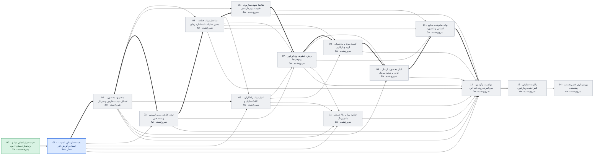

# وضعیت پروژه عالیخان — ۱۵ آبان ۱۴۰۵

> تاریخ‌ها برآورد برنامه‌ریزی‌اند، نه تعهد. با هر گام قبول‌شده، ضریب سرعت واقعی جایگزین فرض می‌شود.

## خلاصه

- **فاز فعال:** PHASE_01 هسته سازمانی، امنیت، اسناد و گردش کار (فعال)
- **گام جاری:** 01.5 UI (در صف)
- **پیشرفت:** 12/120 گام قبول‌شده
- **آماده تست شما:** 0 مورد
- **تصمیم P0 باز (کل پروژه):** 17
- **شروع پایلوت (PHASE_13):** خوش‌بینانه ۲۰ دی ۱۴۰۵ · مبنا **۱۴ بهمن ۱۴۰۵** · بدبینانه ۴ فروردین ۱۴۰۶
- **مسیر بحرانی:** 00 → 01 → 02 → 03 → 04 → 05 → 07 → 08 → 09 → 10 → 12 → 13 — تا شروع پایلوت 36 هفته برآوردی

## آماده تست

هنوز چیزی برای تست عملیاتی آماده نیست.

## منتظر تصمیم شما (افق فعلی)

| شناسه | اولویت | موضوع | مالک | وضعیت |
|---|---|---|---|---|
| DEC-027 | P1 | صفحات ۱ و ۲ HTML مستقل ندارند؛ scope approval و Design System | کارفرما + UI Lead | OPEN |

## گراف وابستگی فازها

## جدول فازها

| فاز | عنوان | وابستگی | وضعیت | گام قبول | برآورد (هفته) | شروع | پایان (مبنا) |
|---|---|---|---|---|---|---|---|
| PHASE_00 | تثبیت قراردادهای مبنا و راه‌اندازی مخزن امن | — | پذیرفته‌شده | 8/8 | 2 | ۱۴۰۵/۰۸/۱۲ | ۱۴۰۵/۰۸/۱۳ |
| PHASE_01 | هسته سازمانی، امنیت، اسناد و گردش کار | 00 | فعال | 4/8 | 3 | ۱۴۰۵/۰۸/۱۳ | ۱۴۰۵/۰۸/۱۹ |
| PHASE_02 | مشتری، محصول، استایل، ثبت سفارش و سریال | 01 | شروع‌نشده | 0/8 | 3 | ۱۴۰۵/۰۸/۱۹ | ۱۴۰۵/۰۸/۲۷ |
| PHASE_03 | تیغه، کلیشه، مقر، لیویس و بسته فنی | 01, 02 | شروع‌نشده | 0/8 | 4 | ۱۴۰۵/۰۸/۲۷ | ۱۴۰۵/۰۹/۰۸ |
| PHASE_04 | ساختار مواد، قطعه، مسیر عملیات، استاندارد زمان | 02, 03 | شروع‌نشده | 0/8 | 4 | ۱۴۰۵/۰۹/۰۸ | ۱۴۰۵/۰۹/۱۹ |
| PHASE_05 | تقاضا، تعهد، سناریوی ظرفیت و زمان‌بندی | 02, 04 | شروع‌نشده | 0/8 | 4 | ۱۴۰۵/۰۹/۱۹ | ۱۴۰۵/۰۹/۳۰ |
| PHASE_06 | انبار مواد، راهکاران، تفکیک و GAP | 01, 02, 04 | شروع‌نشده | 0/8 | 4 | ۱۴۰۵/۰۹/۱۹ | ۱۴۰۵/۰۹/۳۰ |
| PHASE_07 | برش، خطوط، بچ، اپراتور و توقف‌ها | 03, 04, 05, 06 | شروع‌نشده | 0/8 | 5 | ۱۴۰۵/۰۹/۳۰ | ۱۴۰۵/۱۰/۱۴ |
| PHASE_08 | کیفیت مواد و محصول، گرید و بازکاری | 04, 06, 07 | شروع‌نشده | 0/8 | 3 | ۱۴۰۵/۱۰/۱۴ | ۱۴۰۵/۱۰/۲۲ |
| PHASE_09 | انبار محصول، ارسال جزئی و بستن سریال | 02, 07, 08 | شروع‌نشده | 0/8 | 2 | ۱۴۰۵/۱۰/۲۲ | ۱۴۰۵/۱۰/۲۸ |
| PHASE_10 | بهای تمام‌شده، منابع انسانی و داشبورد | 04, 05, 07, 09 | شروع‌نشده | 0/8 | 3 | ۱۴۰۵/۱۰/۲۸ | ۱۴۰۵/۱۱/۰۶ |
| PHASE_11 | دستیار AI، قوانین پویا و مانیتورینگ | 01, 02, 06, 07 | شروع‌نشده | 0/8 | 3 | ۱۴۰۵/۱۰/۱۴ | ۱۴۰۵/۱۰/۲۲ |
| PHASE_12 | مهاجرت و آزمون سرتاسری روی داده امن | 01, 02, 03, 04, 05, 06, 07, 08, 09, 10, 11 | شروع‌نشده | 0/8 | 3 | ۱۴۰۵/۱۱/۰۶ | ۱۴۰۵/۱۱/۱۴ |
| PHASE_13 | پایلوت عملیاتی کنترل‌شده و بازخورد | 12 | شروع‌نشده | 0/8 | 4 | ۱۴۰۵/۱۱/۱۴ | ۱۴۰۵/۱۱/۲۵ |
| PHASE_14 | بهره‌برداری کنترل‌شده و پشتیبانی | 13 | شروع‌نشده | 0/8 | 4 | ۱۴۰۵/۱۱/۲۵ | ۱۴۰۵/۱۲/۰۶ |

## آخرین رویدادها

- `2026-11-06T01:12:44+00:00` step phase=PHASE_01 step=01.4 state=PASS
- `2026-11-05T23:20:43+00:00` step phase=PHASE_01 step=01.4 state=IN_REVIEW commit=f6a60a5
- `2026-11-05T18:39:39+00:00` step phase=PHASE_01 step=01.4 state=IN_PROGRESS
- `2026-11-05T18:39:26+00:00` step phase=PHASE_01 step=01.3 state=PASS
- `2026-11-05T18:31:27+00:00` step phase=PHASE_01 step=01.3 state=IN_REVIEW commit=3f1f3ab
- `2026-11-05T18:12:46+00:00` decision id=DEC-055 status=APPROVED by=بسام ربیهاوی note=B: خودتأییدی یک‌باره مالک فقط برای اولین دارنده هر نقش تأیید کسب‌وکار؛ تأیید دومرحله‌ای تازه + علامت ویژه در Audit
- `2026-11-05T17:40:48+00:00` decision_added id=DEC-055 status=OPEN
- `2026-11-05T17:40:03+00:00` step phase=PHASE_01 step=01.3 state=IN_PROGRESS
- `2026-11-05T17:40:03+00:00` step phase=PHASE_01 step=01.3 state=REWORK
- `2026-11-05T17:29:18+00:00` step phase=PHASE_01 step=01.3 state=IN_REVIEW commit=6fc3eea
- `2026-11-05T08:15:00+00:00` step phase=PHASE_01 step=01.3 state=IN_PROGRESS
- `2026-11-05T04:38:39+00:00` step phase=PHASE_01 step=01.2 state=PASS
- `2026-11-05T04:25:46+00:00` step phase=PHASE_01 step=01.2 state=IN_REVIEW commit=153651f
- `2026-11-05T04:25:45+00:00` step phase=PHASE_01 step=01.2 state=IN_PROGRESS
- `2026-11-05T04:03:19+00:00` step phase=PHASE_01 step=01.2 state=REWORK
