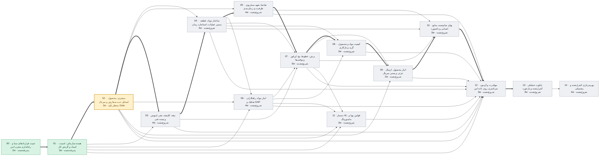

# وضعیت پروژه عالیخان — ۲۷ آبان ۱۴۰۵

> تاریخ‌ها برآورد برنامه‌ریزی‌اند، نه تعهد. با هر گام قبول‌شده، ضریب سرعت واقعی جایگزین فرض می‌شود.

## خلاصه

- **فاز فعال:** PHASE_02 مشتری، محصول، استایل، ثبت سفارش و سریال (منتظر تأیید Gate)
- **گام جاری:** 02.8 Report & Review (در حال انجام)
- **پیشرفت:** 23/120 گام قبول‌شده
- **آماده تست شما:** 0 مورد
- **تصمیم P0 باز (کل پروژه):** 15
- **شروع پایلوت (PHASE_13):** خوش‌بینانه ۲۶ دی ۱۴۰۵ · مبنا **۱۷ بهمن ۱۴۰۵** · بدبینانه ۲۹ اسفند ۱۴۰۵
- **مسیر بحرانی:** 00 → 01 → 02 → 03 → 04 → 05 → 07 → 08 → 09 → 10 → 12 → 13 — تا شروع پایلوت 36 هفته برآوردی

## آماده تست

هنوز چیزی برای تست عملیاتی آماده نیست.

## منتظر تصمیم شما (افق فعلی)

تصمیم بازی در افق فعلی نیست.

## گراف وابستگی فازها

## جدول فازها

| فاز | عنوان | وابستگی | وضعیت | گام قبول | برآورد (هفته) | شروع | پایان (مبنا) |
|---|---|---|---|---|---|---|---|
| PHASE_00 | تثبیت قراردادهای مبنا و راه‌اندازی مخزن امن | — | پذیرفته‌شده | 8/8 | 2 | ۱۴۰۵/۰۸/۱۲ | ۱۴۰۵/۰۸/۱۳ |
| PHASE_01 | هسته سازمانی، امنیت، اسناد و گردش کار | 00 | پذیرفته‌شده | 8/8 | 3 | ۱۴۰۵/۰۸/۱۳ | ۱۴۰۵/۰۸/۲۰ |
| PHASE_02 | مشتری، محصول، استایل، ثبت سفارش و سریال | 01 | منتظر تأیید Gate | 7/8 | 3 | ۱۴۰۵/۰۸/۲۰ | ۱۴۰۵/۰۸/۳۰ |
| PHASE_03 | تیغه، کلیشه، مقر، لیویس و بسته فنی | 01, 02 | شروع‌نشده | 0/8 | 4 | ۱۴۰۵/۰۸/۳۰ | ۱۴۰۵/۰۹/۱۱ |
| PHASE_04 | ساختار مواد، قطعه، مسیر عملیات، استاندارد زمان | 02, 03 | شروع‌نشده | 0/8 | 4 | ۱۴۰۵/۰۹/۱۱ | ۱۴۰۵/۰۹/۲۲ |
| PHASE_05 | تقاضا، تعهد، سناریوی ظرفیت و زمان‌بندی | 02, 04 | شروع‌نشده | 0/8 | 4 | ۱۴۰۵/۰۹/۲۲ | ۱۴۰۵/۱۰/۰۳ |
| PHASE_06 | انبار مواد، راهکاران، تفکیک و GAP | 01, 02, 04 | شروع‌نشده | 0/8 | 4 | ۱۴۰۵/۰۹/۲۲ | ۱۴۰۵/۱۰/۰۳ |
| PHASE_07 | برش، خطوط، بچ، اپراتور و توقف‌ها | 03, 04, 05, 06 | شروع‌نشده | 0/8 | 5 | ۱۴۰۵/۱۰/۰۳ | ۱۴۰۵/۱۰/۱۷ |
| PHASE_08 | کیفیت مواد و محصول، گرید و بازکاری | 04, 06, 07 | شروع‌نشده | 0/8 | 3 | ۱۴۰۵/۱۰/۱۷ | ۱۴۰۵/۱۰/۲۵ |
| PHASE_09 | انبار محصول، ارسال جزئی و بستن سریال | 02, 07, 08 | شروع‌نشده | 0/8 | 2 | ۱۴۰۵/۱۰/۲۵ | ۱۴۰۵/۱۱/۰۱ |
| PHASE_10 | بهای تمام‌شده، منابع انسانی و داشبورد | 04, 05, 07, 09 | شروع‌نشده | 0/8 | 3 | ۱۴۰۵/۱۱/۰۱ | ۱۴۰۵/۱۱/۰۹ |
| PHASE_11 | دستیار AI، قوانین پویا و مانیتورینگ | 01, 02, 06, 07 | شروع‌نشده | 0/8 | 3 | ۱۴۰۵/۱۰/۱۷ | ۱۴۰۵/۱۰/۲۵ |
| PHASE_12 | مهاجرت و آزمون سرتاسری روی داده امن | 01, 02, 03, 04, 05, 06, 07, 08, 09, 10, 11 | شروع‌نشده | 0/8 | 3 | ۱۴۰۵/۱۱/۰۹ | ۱۴۰۵/۱۱/۱۷ |
| PHASE_13 | پایلوت عملیاتی کنترل‌شده و بازخورد | 12 | شروع‌نشده | 0/8 | 4 | ۱۴۰۵/۱۱/۱۷ | ۱۴۰۵/۱۱/۲۸ |
| PHASE_14 | بهره‌برداری کنترل‌شده و پشتیبانی | 13 | شروع‌نشده | 0/8 | 4 | ۱۴۰۵/۱۱/۲۸ | ۱۴۰۵/۱۲/۰۹ |

## آخرین رویدادها

- `2026-11-18T17:50:25+00:00` decision id=DEC-061 status=APPROVED by=بسام ربیهاوی note=Amendment 2026-11-18: (1) pages without a tablet mockup (1, 2) are measured at 768 against the catalogue's shared shell for shell regions; (2) required sections absent from the mockup are allowed only below the mockup content (or in a separate tab/dialog); the fidelity test penalises extra sections placed above or between mockup regions
- `2026-11-18T14:19:46+00:00` decision id=DEC-005 status=APPROVED by=بسام ربیهاوی note=Amendment 2026-11-18 (REV-0293, option A): a style can be activated and a product code issued only while its product is ACTIVE
- `2026-11-17T17:42:47+00:00` decision id=DEC-061 status=APPROVED by=بسام ربیهاوی note=UI fidelity: every built page must match its design-catalogue mockup at >=95% (orchestrator's fidelity test, 4 widths) before acceptance; each phase's mockups reviewed/approved by the employer before the phase starts; mockup layout frame built from the start, only polish at the end; PHASE_02 pages 1,2,4,29,33 brought to >=95% before the PHASE_02 Gate
- `2026-11-17T17:42:47+00:00` decision_added id=DEC-061 status=OPEN
- `2026-11-17T17:32:07+00:00` step phase=PHASE_02 step=02.8 state=IN_PROGRESS
- `2026-11-17T17:32:07+00:00` step phase=PHASE_02 step=02.8 state=REWORK note=Gate follow-up: REV-0290..0294 (reports/phase-02/step-8/GATE_FOLLOWUP_REVS.md)
- `2026-11-17T17:30:47+00:00` decision id=DEC-005 status=APPROVED by=بسام ربیهاوی note=Amendment 2026-11-17 (Gate PHASE_02 item g): a DISMISSED disputed legacy value also carries over to later Planning imports and is not raised again (overrides the 02.8 re-raise interpretation)
- `2026-11-17T17:28:48+00:00` decision id=DEC-032 status=APPROVED by=بسام ربیهاوی note=Amendment 2026-11-17 (REV-0254): the approval inbox and page 33 show the requester's display name (internal user display name only) next to the short id
- `2026-11-17T17:27:48+00:00` decision id=DEC-059 status=APPROVED by=بسام ربیهاوی note=Amendment 2026-11-17 (REV-0203): at most one open (SUBMITTED/APPROVED) change request per order; an unanswered SUBMITTED/APPROVED change request expires after 30 days
- `2026-11-17T17:24:27+00:00` test_result id=T-004 result=PASS
- `2026-11-16T06:37:42+00:00` test_ready id=T-004 phase=PHASE_02
- `2026-11-16T06:37:42+00:00` step phase=PHASE_02 step=02.8 state=PASS
- `2026-11-16T06:37:42+00:00` gate_pending phase=PHASE_02
- `2026-11-16T06:25:29+00:00` step phase=PHASE_02 step=02.8 state=IN_REVIEW commit=b359715
- `2026-11-16T04:22:39+00:00` step phase=PHASE_02 step=02.8 state=IN_PROGRESS
