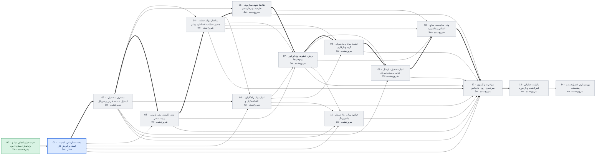

# وضعیت پروژه عالیخان — ۱۹ آبان ۱۴۰۵

> تاریخ‌ها برآورد برنامه‌ریزی‌اند، نه تعهد. با هر گام قبول‌شده، ضریب سرعت واقعی جایگزین فرض می‌شود.

## خلاصه

- **فاز فعال:** PHASE_01 هسته سازمانی، امنیت، اسناد و گردش کار (فعال)
- **گام جاری:** 01.6 Integration (در صف)
- **پیشرفت:** 13/120 گام قبول‌شده
- **آماده تست شما:** 1 مورد
- **تصمیم P0 باز (کل پروژه):** 17
- **شروع پایلوت (PHASE_13):** خوش‌بینانه ۲۳ دی ۱۴۰۵ · مبنا **۱۷ بهمن ۱۴۰۵** · بدبینانه ۷ فروردین ۱۴۰۶
- **مسیر بحرانی:** 00 → 01 → 02 → 03 → 04 → 05 → 07 → 08 → 09 → 10 → 12 → 13 — تا شروع پایلوت 36 هفته برآوردی

## آماده تست

| شناسه | فاز | چه چیزی | چطور تست کنید |
|---|---|---|---|
| T-003 | PHASE_01 | صفحه‌های فاز ۱: ورود و تأیید دومرحله‌ای، امنیت و کاربران (۴۶)، درخت سازمانی، کارها و تأییدها (۳۹)، اسناد (۴۰)، پارامترها (۴۲)، سلامت سامانه (۳۶) | راهنمای قدم‌به‌قدم: reports/phase-01/step-5/UAT_HOWTO_FA.md — نشانی http://127.0.0.1:5173/ ؛ سرورها را ارکستراتور برای شما روشن می‌کند؛ داده‌ها ساختگی‌اند |

## منتظر تصمیم شما (افق فعلی)

| شناسه | اولویت | موضوع | مالک | وضعیت |
|---|---|---|---|---|
| DEC-027 | P1 | صفحات ۱ و ۲ HTML مستقل ندارند؛ scope approval و Design System | کارفرما + UI Lead | OPEN |

## گراف وابستگی فازها

## جدول فازها

| فاز | عنوان | وابستگی | وضعیت | گام قبول | برآورد (هفته) | شروع | پایان (مبنا) |
|---|---|---|---|---|---|---|---|
| PHASE_00 | تثبیت قراردادهای مبنا و راه‌اندازی مخزن امن | — | پذیرفته‌شده | 8/8 | 2 | ۱۴۰۵/۰۸/۱۲ | ۱۴۰۵/۰۸/۱۳ |
| PHASE_01 | هسته سازمانی، امنیت، اسناد و گردش کار | 00 | فعال | 5/8 | 3 | ۱۴۰۵/۰۸/۱۳ | ۱۴۰۵/۰۸/۲۲ |
| PHASE_02 | مشتری، محصول، استایل، ثبت سفارش و سریال | 01 | شروع‌نشده | 0/8 | 3 | ۱۴۰۵/۰۸/۲۲ | ۱۴۰۵/۰۸/۳۰ |
| PHASE_03 | تیغه، کلیشه، مقر، لیویس و بسته فنی | 01, 02 | شروع‌نشده | 0/8 | 4 | ۱۴۰۵/۰۸/۳۰ | ۱۴۰۵/۰۹/۱۱ |
| PHASE_04 | ساختار مواد، قطعه، مسیر عملیات، استاندارد زمان | 02, 03 | شروع‌نشده | 0/8 | 4 | ۱۴۰۵/۰۹/۱۱ | ۱۴۰۵/۰۹/۲۲ |
| PHASE_05 | تقاضا، تعهد، سناریوی ظرفیت و زمان‌بندی | 02, 04 | شروع‌نشده | 0/8 | 4 | ۱۴۰۵/۰۹/۲۲ | ۱۴۰۵/۱۰/۰۳ |
| PHASE_06 | انبار مواد، راهکاران، تفکیک و GAP | 01, 02, 04 | شروع‌نشده | 0/8 | 4 | ۱۴۰۵/۰۹/۲۲ | ۱۴۰۵/۱۰/۰۳ |
| PHASE_07 | برش، خطوط، بچ، اپراتور و توقف‌ها | 03, 04, 05, 06 | شروع‌نشده | 0/8 | 5 | ۱۴۰۵/۱۰/۰۳ | ۱۴۰۵/۱۰/۱۷ |
| PHASE_08 | کیفیت مواد و محصول، گرید و بازکاری | 04, 06, 07 | شروع‌نشده | 0/8 | 3 | ۱۴۰۵/۱۰/۱۷ | ۱۴۰۵/۱۰/۲۵ |
| PHASE_09 | انبار محصول، ارسال جزئی و بستن سریال | 02, 07, 08 | شروع‌نشده | 0/8 | 2 | ۱۴۰۵/۱۰/۲۵ | ۱۴۰۵/۱۱/۰۱ |
| PHASE_10 | بهای تمام‌شده، منابع انسانی و داشبورد | 04, 05, 07, 09 | شروع‌نشده | 0/8 | 3 | ۱۴۰۵/۱۱/۰۱ | ۱۴۰۵/۱۱/۰۹ |
| PHASE_11 | دستیار AI، قوانین پویا و مانیتورینگ | 01, 02, 06, 07 | شروع‌نشده | 0/8 | 3 | ۱۴۰۵/۱۰/۱۷ | ۱۴۰۵/۱۰/۲۵ |
| PHASE_12 | مهاجرت و آزمون سرتاسری روی داده امن | 01, 02, 03, 04, 05, 06, 07, 08, 09, 10, 11 | شروع‌نشده | 0/8 | 3 | ۱۴۰۵/۱۱/۰۹ | ۱۴۰۵/۱۱/۱۷ |
| PHASE_13 | پایلوت عملیاتی کنترل‌شده و بازخورد | 12 | شروع‌نشده | 0/8 | 4 | ۱۴۰۵/۱۱/۱۷ | ۱۴۰۵/۱۱/۲۸ |
| PHASE_14 | بهره‌برداری کنترل‌شده و پشتیبانی | 13 | شروع‌نشده | 0/8 | 4 | ۱۴۰۵/۱۱/۲۸ | ۱۴۰۵/۱۲/۰۹ |

## آخرین رویدادها

- `2026-11-10T03:59:29+00:00` test_ready id=T-003 phase=PHASE_01
- `2026-11-10T03:59:29+00:00` step phase=PHASE_01 step=01.5 state=PASS
- `2026-11-09T18:28:57+00:00` step phase=PHASE_01 step=01.5 state=IN_REVIEW commit=ef4902a
- `2026-11-06T01:15:53+00:00` step phase=PHASE_01 step=01.5 state=IN_PROGRESS
- `2026-11-06T01:15:34+00:00` decision id=DEC-056 status=APPROVED by=بسام ربیهاوی note=owner_admin: approval.read همه + approval.decide مستقیم؛ maker≠checker (DEC-032) بدون تغییر؛ ماتریس v1.1
- `2026-11-06T01:15:34+00:00` decision_added id=DEC-056 status=OPEN
- `2026-11-06T01:12:44+00:00` step phase=PHASE_01 step=01.4 state=PASS
- `2026-11-05T23:20:43+00:00` step phase=PHASE_01 step=01.4 state=IN_REVIEW commit=f6a60a5
- `2026-11-05T18:39:39+00:00` step phase=PHASE_01 step=01.4 state=IN_PROGRESS
- `2026-11-05T18:39:26+00:00` step phase=PHASE_01 step=01.3 state=PASS
- `2026-11-05T18:31:27+00:00` step phase=PHASE_01 step=01.3 state=IN_REVIEW commit=3f1f3ab
- `2026-11-05T18:12:46+00:00` decision id=DEC-055 status=APPROVED by=بسام ربیهاوی note=B: خودتأییدی یک‌باره مالک فقط برای اولین دارنده هر نقش تأیید کسب‌وکار؛ تأیید دومرحله‌ای تازه + علامت ویژه در Audit
- `2026-11-05T17:40:48+00:00` decision_added id=DEC-055 status=OPEN
- `2026-11-05T17:40:03+00:00` step phase=PHASE_01 step=01.3 state=IN_PROGRESS
- `2026-11-05T17:40:03+00:00` step phase=PHASE_01 step=01.3 state=REWORK
