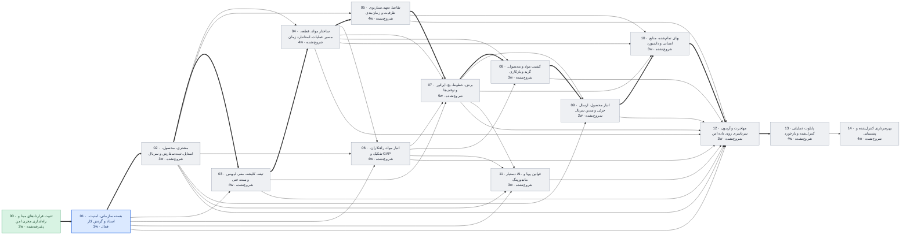

# وضعیت پروژه عالیخان — ۱۳ آبان ۱۴۰۵

> تاریخ‌ها برآورد برنامه‌ریزی‌اند، نه تعهد. با هر گام قبول‌شده، ضریب سرعت واقعی جایگزین فرض می‌شود.

## خلاصه

- **فاز فعال:** PHASE_01 هسته سازمانی، امنیت، اسناد و گردش کار (فعال)
- **گام جاری:** 01.2 Database (در صف)
- **پیشرفت:** 9/120 گام قبول‌شده
- **آماده تست شما:** 0 مورد
- **تصمیم P0 باز (کل پروژه):** 17
- **شروع پایلوت (PHASE_13):** خوش‌بینانه ۲۰ دی ۱۴۰۵ · مبنا **۱۵ بهمن ۱۴۰۵** · بدبینانه ۷ فروردین ۱۴۰۶
- **مسیر بحرانی:** 00 → 01 → 02 → 03 → 04 → 05 → 07 → 08 → 09 → 10 → 12 → 13 — تا شروع پایلوت 36 هفته برآوردی

## آماده تست

هنوز چیزی برای تست عملیاتی آماده نیست.

## منتظر تصمیم شما (افق فعلی)

| شناسه | اولویت | موضوع | مالک | وضعیت |
|---|---|---|---|---|
| DEC-027 | P1 | صفحات ۱ و ۲ HTML مستقل ندارند؛ scope approval و Design System | کارفرما + UI Lead | OPEN |

## گراف وابستگی فازها

## جدول فازها

| فاز | عنوان | وابستگی | وضعیت | گام قبول | برآورد (هفته) | شروع | پایان (مبنا) |
|---|---|---|---|---|---|---|---|
| PHASE_00 | تثبیت قراردادهای مبنا و راه‌اندازی مخزن امن | — | پذیرفته‌شده | 8/8 | 2 | ۱۴۰۵/۰۸/۱۲ | ۱۴۰۵/۰۸/۱۳ |
| PHASE_01 | هسته سازمانی، امنیت، اسناد و گردش کار | 00 | فعال | 1/8 | 3 | ۱۴۰۵/۰۸/۱۳ | ۱۴۰۵/۰۸/۲۰ |
| PHASE_02 | مشتری، محصول، استایل، ثبت سفارش و سریال | 01 | شروع‌نشده | 0/8 | 3 | ۱۴۰۵/۰۸/۲۰ | ۱۴۰۵/۰۸/۲۸ |
| PHASE_03 | تیغه، کلیشه، مقر، لیویس و بسته فنی | 01, 02 | شروع‌نشده | 0/8 | 4 | ۱۴۰۵/۰۸/۲۸ | ۱۴۰۵/۰۹/۰۹ |
| PHASE_04 | ساختار مواد، قطعه، مسیر عملیات، استاندارد زمان | 02, 03 | شروع‌نشده | 0/8 | 4 | ۱۴۰۵/۰۹/۰۹ | ۱۴۰۵/۰۹/۲۰ |
| PHASE_05 | تقاضا، تعهد، سناریوی ظرفیت و زمان‌بندی | 02, 04 | شروع‌نشده | 0/8 | 4 | ۱۴۰۵/۰۹/۲۰ | ۱۴۰۵/۱۰/۰۱ |
| PHASE_06 | انبار مواد، راهکاران، تفکیک و GAP | 01, 02, 04 | شروع‌نشده | 0/8 | 4 | ۱۴۰۵/۰۹/۲۰ | ۱۴۰۵/۱۰/۰۱ |
| PHASE_07 | برش، خطوط، بچ، اپراتور و توقف‌ها | 03, 04, 05, 06 | شروع‌نشده | 0/8 | 5 | ۱۴۰۵/۱۰/۰۱ | ۱۴۰۵/۱۰/۱۵ |
| PHASE_08 | کیفیت مواد و محصول، گرید و بازکاری | 04, 06, 07 | شروع‌نشده | 0/8 | 3 | ۱۴۰۵/۱۰/۱۵ | ۱۴۰۵/۱۰/۲۳ |
| PHASE_09 | انبار محصول، ارسال جزئی و بستن سریال | 02, 07, 08 | شروع‌نشده | 0/8 | 2 | ۱۴۰۵/۱۰/۲۳ | ۱۴۰۵/۱۰/۲۹ |
| PHASE_10 | بهای تمام‌شده، منابع انسانی و داشبورد | 04, 05, 07, 09 | شروع‌نشده | 0/8 | 3 | ۱۴۰۵/۱۰/۲۹ | ۱۴۰۵/۱۱/۰۷ |
| PHASE_11 | دستیار AI، قوانین پویا و مانیتورینگ | 01, 02, 06, 07 | شروع‌نشده | 0/8 | 3 | ۱۴۰۵/۱۰/۱۵ | ۱۴۰۵/۱۰/۲۳ |
| PHASE_12 | مهاجرت و آزمون سرتاسری روی داده امن | 01, 02, 03, 04, 05, 06, 07, 08, 09, 10, 11 | شروع‌نشده | 0/8 | 3 | ۱۴۰۵/۱۱/۰۷ | ۱۴۰۵/۱۱/۱۵ |
| PHASE_13 | پایلوت عملیاتی کنترل‌شده و بازخورد | 12 | شروع‌نشده | 0/8 | 4 | ۱۴۰۵/۱۱/۱۵ | ۱۴۰۵/۱۱/۲۶ |
| PHASE_14 | بهره‌برداری کنترل‌شده و پشتیبانی | 13 | شروع‌نشده | 0/8 | 4 | ۱۴۰۵/۱۱/۲۶ | ۱۴۰۵/۱۲/۰۷ |

## آخرین رویدادها

- `2026-11-04T15:48:21+00:00` decision id=DEC-032 status=APPROVED by=بسام ربیهاوی note=پاسخ کارفرما ۲۰۲۶-۱۱-۰۴: بخش ۱ = B (متوسط): maker≠checker برای approveDocumentRevision، publishParameterValue پارامترهای BUSINESS_RULE، و createRoleAssignment نقش‌های دارای حق تأیید کسب‌وکار؛ تا تعریف نفر دوم این موارد «در انتظار» می‌مانند. بن‌بست یک‌نفره = D1 (هرگز خودتأیید؛ تأیید اضطراری فقط با تصمیم بعدی). انقضای درخواست تأیید ۳۰ روز. بخش ۲ = R-A: Audit کسب‌وکار و دسترسی هرگز حذف نشود (بایگانی سالانه)؛ رخدادهای ورود ۲ سال؛ مدت الزام قانونی را مشاور حقوقی/مالی تأیید کند.
- `2026-11-04T15:44:43+00:00` decision id=DEC-054 status=APPROVED by=بسام ربیهاوی note=پاسخ کارفرما ۲۰۲۶-۱۱-۰۴: C از ابتدا (دستور بازیابی روی کنسول سرور با دسترسی فیزیکی/SSH، بازنشانی رمز/MFA مالک با Audit) + A پیش از Production (حساب اضطراری مهروموم در گاوصندوق، هشدار فوری و Audit ویژه، جلسه ۲ ساعته، تعویض رمز پس از هر استفاده). B (ادمین دوم) فعلاً نه.
- `2026-11-04T15:43:06+00:00` decision id=DEC-053 status=APPROVED by=بسام ربیهاوی note=پاسخ کارفرما ۲۰۲۶-۱۱-۰۴: ضدبدافزار AV-A = ClamAV در کانتینر ایزوله روی همان سرور (بدون ارسال فایل به بیرون) + فهرست سفید نوع + بررسی magic bytes + سقف حجم. انواع مجاز: PDF، PNG، JPG، DXF، XLSX بدون ماکرو؛ XLSM/DOCM/EXE/اسکریپت هرگز. حداکثر ۲۵ مگابایت (تغییر برای DXF با تصمیم تازه). ذخیره ST-A: پوشه رمزگذاری‌شده روی سرور داخلی. فایل ردشده ۳۰ روز قرنطینه سپس حذف بایت‌ها (متادیتا و هش می‌ماند). هیچ فایل در مرورگر نمایش/اجرا نمی‌شود؛ فقط دانلود.
- `2026-11-04T15:41:27+00:00` decision id=DEC-052 status=APPROVED by=بسام ربیهاوی note=پاسخ کارفرما ۲۰۲۶-۱۱-۰۴: شبکه N-A: فهرست صریح CIDR فقط در تنظیمات سرور (نه Git)، IP فقط از پراکسی معتمد؛ نامعلوم = بیرون؛ VPN = بیرون (MFA لازم). حساب اپراتور O-A: حساب شخصی هر اپراتور، فقط از شبکه داخلی؛ حساب ایستگاه + کارت/PIN در فاز ۷ با DEC-018 بررسی می‌شود.
- `2026-11-04T15:40:05+00:00` decision id=DEC-051 status=APPROVED by=بسام ربیهاوی note=پاسخ کارفرما ۲۰۲۶-۱۱-۰۴: (۱) رمز به روش سنتی (گزینه B): حداقل ۸ نویسه + ترکیب اجباری (حرف بزرگ، عدد، نماد) + تعویض هر ۹۰ روز. (۲) رمز اولیه یک‌بارمصرف ساخته ادمین، اعتبار ۷۲ ساعت، تعویض اجباری در اولین ورود. (۳) قفل L1: ۵ ورود ناموفق در ۱۵ دقیقه → قفل خودکار ۱۵ دقیقه + اعلان در صفحه ۳۶/۴۶. (۴) جلسه S2 برای کاربران عادی (بی‌کاری ۲ ساعت، حداکثر ۱۲ ساعت) و S3 برای اپراتورها (بی‌کاری ۸ ساعت، فقط شبکه داخلی). (۵) حداکثر ۳ جلسه همزمان. (۶) پنجره step-up ۱۵ دقیقه.
- `2026-11-04T15:37:37+00:00` step phase=PHASE_01 step=01.1 state=PASS
- `2026-11-04T15:37:27+00:00` decision id=DEC-050 status=APPROVED by=بسام ربیهاوی note=پاسخ کارفرما ۲۰۲۶-۱۱-۰۴: عامل دوم = TOTP (برنامه کد روی گوشی، مثل Google/Microsoft Authenticator)؛ کلید سخت‌افزاری/passkey بعداً اختیاری. بازیابی = ۱۰ کد بازیابی یک‌بارمصرف + بازنشانی توسط ادمین با دلیل، MFA ادمین و Audit (R1+R2)؛ بازیابی مالک طبق DEC-054. پنجره step-up در DEC-051.
- `2026-11-04T15:24:17+00:00` decision id=DEC-049 status=APPROVED by=بسام ربیهاوی note=matrix v0.1 approved (2026-11-04). پاسخ‌ها: (۱) هر ۱۱ نقش ساخته شوند. (۲) it_ops هم قفل کاربر را باز کند (با MFA و Audit؛ بدون تغییر رمز). (۴) کارفرما در شروع فقط owner_admin دارد؛ نقش‌های کسب‌وکار بعداً و صریح با علامت خودانتسابی. (۵) MFA تازه برای همه ردیف‌های MFA حتی داخل شبکه کارخانه. (۳) سطح دیدن اسناد جدا پرسیده نشد: پیش‌فرض v0.1 (EMP: S1، MGR/MGT: S1–S2) اجرا می‌شود و کارفرما می‌تواند تغییر دهد.
- `2026-11-04T15:15:38+00:00` decision id=DEC-048 status=APPROVED by=بسام ربیهاوی note=پاسخ کارفرما ۲۰۲۶-۱۱-۰۴: (۴) مسیر تأیید ترکیبی (گزینه C)، ولی در فاز ۱ همه گردش‌ها فقط نقش + دامنه واحد (A)؛ هر ماژول مسیرش را در فاز خودش تصویب می‌کند. (۱) سطوح ثابت قابل افزایش توسط ادمین: COMPANY, DEPARTMENT, SECTION, LINE، حداکثر ۶ سطح. (۲) یک سمت اصلی + ACTING با تاریخ پایان؛ بدون سمت اضافی در فاز ۱. (۳) reports-to بین سمت‌ها. (۵) ویرایش فقط کارفرما/ادمین در فاز ۱. (۶) نام واحد/سمت/فرد برای همه کاربران داخلی؛ بدون اطلاعات تماس. (۷) تاریخچه با تاریخ اثر.
- `2026-11-04T15:13:08+00:00` step phase=PHASE_01 step=01.1 state=IN_REVIEW commit=89e5f0d
- `2026-11-04T15:13:08+00:00` decision_added id=DEC-054 status=OPEN
- `2026-11-04T15:13:08+00:00` decision_added id=DEC-053 status=OPEN
- `2026-11-04T15:13:08+00:00` decision_added id=DEC-052 status=OPEN
- `2026-11-04T15:13:07+00:00` decision_added id=DEC-051 status=OPEN
- `2026-11-04T15:13:07+00:00` decision_added id=DEC-050 status=OPEN
