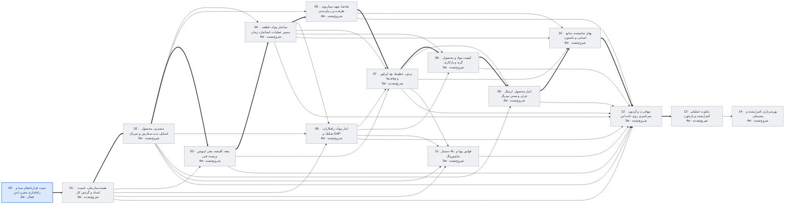

# وضعیت پروژه عالیخان — ۱۳ آبان ۱۴۰۵

> تاریخ‌ها برآورد برنامه‌ریزی‌اند، نه تعهد. با هر گام قبول‌شده، ضریب سرعت واقعی جایگزین فرض می‌شود.

## خلاصه

- **فاز فعال:** PHASE_00 تثبیت قراردادهای مبنا و راه‌اندازی مخزن امن (فعال)
- **گام جاری:** 00.7 Security & Ops (در صف)
- **پیشرفت:** 6/120 گام قبول‌شده
- **آماده تست شما:** 1 مورد
- **تصمیم P0 باز (کل پروژه):** 17
- **شروع پایلوت (PHASE_13):** خوش‌بینانه ۶ بهمن ۱۴۰۵ · مبنا **۱۲ اسفند ۱۴۰۵** · بدبینانه ۱۵ اردیبهشت ۱۴۰۶
- **مسیر بحرانی:** 00 → 01 → 02 → 03 → 04 → 05 → 07 → 08 → 09 → 10 → 12 → 13 — تا شروع پایلوت 36 هفته برآوردی

## آماده تست

| شناسه | فاز | چه چیزی | چطور تست کنید |
|---|---|---|---|
| T-002 | PHASE_00 | T-002 لوگو و رنگ سبز عالیخان روی صفحه وضعیت سامانه | از Claude بخواهید «سرور تست را روشن کن»؛ سپس http://127.0.0.1:5173 را در Edge/Chrome باز کنید: لوگوی عالیخان بالای صفحه (جای «ع»)، دکمه «بررسی مجدد» سبز تیره هم‌رنگ لوگو، برچسب‌های «سالم» سبز روشن‌تر با تیک؛ پنجره را کوچک/بزرگ کنید (موبایل تا دسکتاپ). نتیجه: /test-result T-002 PASS یا FAIL |

## منتظر تصمیم شما (افق فعلی)

تصمیم بازی در افق فعلی نیست.

## گراف وابستگی فازها

## جدول فازها

| فاز | عنوان | وابستگی | وضعیت | گام قبول | برآورد (هفته) | شروع | پایان (مبنا) |
|---|---|---|---|---|---|---|---|
| PHASE_00 | تثبیت قراردادهای مبنا و راه‌اندازی مخزن امن | — | فعال | 6/8 | 2 | ۱۴۰۵/۰۸/۱۲ | ۱۴۰۵/۰۸/۱۵ |
| PHASE_01 | هسته سازمانی، امنیت، اسناد و گردش کار | 00 | شروع‌نشده | 0/8 | 3 | ۱۴۰۵/۰۸/۱۵ | ۱۴۰۵/۰۸/۲۵ |
| PHASE_02 | مشتری، محصول، استایل، ثبت سفارش و سریال | 01 | شروع‌نشده | 0/8 | 3 | ۱۴۰۵/۰۸/۲۵ | ۱۴۰۵/۰۹/۰۵ |
| PHASE_03 | تیغه، کلیشه، مقر، لیویس و بسته فنی | 01, 02 | شروع‌نشده | 0/8 | 4 | ۱۴۰۵/۰۹/۰۵ | ۱۴۰۵/۰۹/۱۹ |
| PHASE_04 | ساختار مواد، قطعه، مسیر عملیات، استاندارد زمان | 02, 03 | شروع‌نشده | 0/8 | 4 | ۱۴۰۵/۰۹/۱۹ | ۱۴۰۵/۱۰/۰۳ |
| PHASE_05 | تقاضا، تعهد، سناریوی ظرفیت و زمان‌بندی | 02, 04 | شروع‌نشده | 0/8 | 4 | ۱۴۰۵/۱۰/۰۳ | ۱۴۰۵/۱۰/۱۷ |
| PHASE_06 | انبار مواد، راهکاران، تفکیک و GAP | 01, 02, 04 | شروع‌نشده | 0/8 | 4 | ۱۴۰۵/۱۰/۰۳ | ۱۴۰۵/۱۰/۱۷ |
| PHASE_07 | برش، خطوط، بچ، اپراتور و توقف‌ها | 03, 04, 05, 06 | شروع‌نشده | 0/8 | 5 | ۱۴۰۵/۱۰/۱۷ | ۱۴۰۵/۱۱/۰۵ |
| PHASE_08 | کیفیت مواد و محصول، گرید و بازکاری | 04, 06, 07 | شروع‌نشده | 0/8 | 3 | ۱۴۰۵/۱۱/۰۵ | ۱۴۰۵/۱۱/۱۵ |
| PHASE_09 | انبار محصول، ارسال جزئی و بستن سریال | 02, 07, 08 | شروع‌نشده | 0/8 | 2 | ۱۴۰۵/۱۱/۱۵ | ۱۴۰۵/۱۱/۲۲ |
| PHASE_10 | بهای تمام‌شده، منابع انسانی و داشبورد | 04, 05, 07, 09 | شروع‌نشده | 0/8 | 3 | ۱۴۰۵/۱۱/۲۲ | ۱۴۰۵/۱۲/۰۲ |
| PHASE_11 | دستیار AI، قوانین پویا و مانیتورینگ | 01, 02, 06, 07 | شروع‌نشده | 0/8 | 3 | ۱۴۰۵/۱۱/۰۵ | ۱۴۰۵/۱۱/۱۵ |
| PHASE_12 | مهاجرت و آزمون سرتاسری روی داده امن | 01, 02, 03, 04, 05, 06, 07, 08, 09, 10, 11 | شروع‌نشده | 0/8 | 3 | ۱۴۰۵/۱۲/۰۲ | ۱۴۰۵/۱۲/۱۲ |
| PHASE_13 | پایلوت عملیاتی کنترل‌شده و بازخورد | 12 | شروع‌نشده | 0/8 | 4 | ۱۴۰۵/۱۲/۱۲ | ۱۴۰۵/۱۲/۲۶ |
| PHASE_14 | بهره‌برداری کنترل‌شده و پشتیبانی | 13 | شروع‌نشده | 0/8 | 4 | ۱۴۰۵/۱۲/۲۶ | ۱۴۰۶/۰۱/۱۱ |

## آخرین رویدادها

- `2026-11-04T05:11:57+00:00` test_ready id=T-002 phase=PHASE_00
- `2026-11-04T05:11:56+00:00` step phase=PHASE_00 step=00.6 state=PASS
- `2026-11-04T05:03:43+00:00` step phase=PHASE_00 step=00.6 state=IN_REVIEW commit=d7b444a8f2e907b8bb6c730faf15a5b455dc5e9e
- `2026-11-04T04:23:33+00:00` step phase=PHASE_00 step=00.6 state=IN_PROGRESS
- `2026-11-04T04:19:00+00:00` test_result id=T-001 result=PASS
- `2026-11-03T20:09:25+00:00` test_ready id=T-001 phase=PHASE_00
- `2026-11-03T20:08:57+00:00` step phase=PHASE_00 step=00.5 state=PASS
- `2026-11-03T20:04:52+00:00` step phase=PHASE_00 step=00.5 state=IN_REVIEW commit=fbd4218e8330226d3677583a054a42e9d1f20fff
- `2026-11-03T19:39:30+00:00` step phase=PHASE_00 step=00.5 state=IN_PROGRESS
- `2026-11-03T19:26:40+00:00` step phase=PHASE_00 step=00.4 state=PASS
- `2026-11-03T19:22:23+00:00` step phase=PHASE_00 step=00.4 state=IN_REVIEW commit=bd332cbb85cf6269533c63c33a0e85f8489b90bd
- `2026-11-03T18:58:43+00:00` step phase=PHASE_00 step=00.4 state=IN_PROGRESS
- `2026-11-03T16:52:07+00:00` step phase=PHASE_00 step=00.3 state=PASS
- `2026-11-03T16:48:39+00:00` step phase=PHASE_00 step=00.3 state=IN_REVIEW commit=a6efb53cff09aefdacb50ef48e092ec0041ced6f
- `2026-11-03T16:29:41+00:00` step phase=PHASE_00 step=00.3 state=IN_PROGRESS
