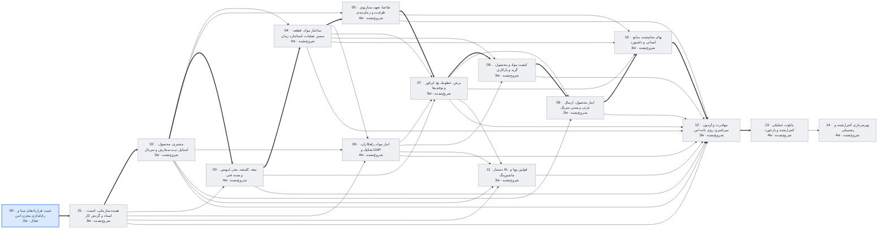

# وضعیت پروژه عالیخان — ۱۲ آبان ۱۴۰۵

> تاریخ‌ها برآورد برنامه‌ریزی‌اند، نه تعهد. با هر گام قبول‌شده، ضریب سرعت واقعی جایگزین فرض می‌شود.

## خلاصه

- **فاز فعال:** PHASE_00 تثبیت قراردادهای مبنا و راه‌اندازی مخزن امن (فعال)
- **گام جاری:** 00.4 Backend/API (در صف)
- **پیشرفت:** 3/120 گام قبول‌شده
- **آماده تست شما:** 0 مورد
- **تصمیم P0 باز (کل پروژه):** 17
- **شروع پایلوت (PHASE_13):** خوش‌بینانه ۷ بهمن ۱۴۰۵ · مبنا **۱۳ اسفند ۱۴۰۵** · بدبینانه ۱۸ اردیبهشت ۱۴۰۶
- **مسیر بحرانی:** 00 → 01 → 02 → 03 → 04 → 05 → 07 → 08 → 09 → 10 → 12 → 13 — تا شروع پایلوت 36 هفته برآوردی

## آماده تست

هنوز چیزی برای تست عملیاتی آماده نیست.

## منتظر تصمیم شما (افق فعلی)

تصمیم بازی در افق فعلی نیست.

## گراف وابستگی فازها

## جدول فازها

| فاز | عنوان | وابستگی | وضعیت | گام قبول | برآورد (هفته) | شروع | پایان (مبنا) |
|---|---|---|---|---|---|---|---|
| PHASE_00 | تثبیت قراردادهای مبنا و راه‌اندازی مخزن امن | — | فعال | 3/8 | 2 | ۱۴۰۵/۰۸/۱۲ | ۱۴۰۵/۰۸/۱۶ |
| PHASE_01 | هسته سازمانی، امنیت، اسناد و گردش کار | 00 | شروع‌نشده | 0/8 | 3 | ۱۴۰۵/۰۸/۱۶ | ۱۴۰۵/۰۸/۲۶ |
| PHASE_02 | مشتری، محصول، استایل، ثبت سفارش و سریال | 01 | شروع‌نشده | 0/8 | 3 | ۱۴۰۵/۰۸/۲۶ | ۱۴۰۵/۰۹/۰۶ |
| PHASE_03 | تیغه، کلیشه، مقر، لیویس و بسته فنی | 01, 02 | شروع‌نشده | 0/8 | 4 | ۱۴۰۵/۰۹/۰۶ | ۱۴۰۵/۰۹/۲۰ |
| PHASE_04 | ساختار مواد، قطعه، مسیر عملیات، استاندارد زمان | 02, 03 | شروع‌نشده | 0/8 | 4 | ۱۴۰۵/۰۹/۲۰ | ۱۴۰۵/۱۰/۰۴ |
| PHASE_05 | تقاضا، تعهد، سناریوی ظرفیت و زمان‌بندی | 02, 04 | شروع‌نشده | 0/8 | 4 | ۱۴۰۵/۱۰/۰۴ | ۱۴۰۵/۱۰/۱۸ |
| PHASE_06 | انبار مواد، راهکاران، تفکیک و GAP | 01, 02, 04 | شروع‌نشده | 0/8 | 4 | ۱۴۰۵/۱۰/۰۴ | ۱۴۰۵/۱۰/۱۸ |
| PHASE_07 | برش، خطوط، بچ، اپراتور و توقف‌ها | 03, 04, 05, 06 | شروع‌نشده | 0/8 | 5 | ۱۴۰۵/۱۰/۱۸ | ۱۴۰۵/۱۱/۰۶ |
| PHASE_08 | کیفیت مواد و محصول، گرید و بازکاری | 04, 06, 07 | شروع‌نشده | 0/8 | 3 | ۱۴۰۵/۱۱/۰۶ | ۱۴۰۵/۱۱/۱۶ |
| PHASE_09 | انبار محصول، ارسال جزئی و بستن سریال | 02, 07, 08 | شروع‌نشده | 0/8 | 2 | ۱۴۰۵/۱۱/۱۶ | ۱۴۰۵/۱۱/۲۳ |
| PHASE_10 | بهای تمام‌شده، منابع انسانی و داشبورد | 04, 05, 07, 09 | شروع‌نشده | 0/8 | 3 | ۱۴۰۵/۱۱/۲۳ | ۱۴۰۵/۱۲/۰۳ |
| PHASE_11 | دستیار AI، قوانین پویا و مانیتورینگ | 01, 02, 06, 07 | شروع‌نشده | 0/8 | 3 | ۱۴۰۵/۱۱/۰۶ | ۱۴۰۵/۱۱/۱۶ |
| PHASE_12 | مهاجرت و آزمون سرتاسری روی داده امن | 01, 02, 03, 04, 05, 06, 07, 08, 09, 10, 11 | شروع‌نشده | 0/8 | 3 | ۱۴۰۵/۱۲/۰۳ | ۱۴۰۵/۱۲/۱۳ |
| PHASE_13 | پایلوت عملیاتی کنترل‌شده و بازخورد | 12 | شروع‌نشده | 0/8 | 4 | ۱۴۰۵/۱۲/۱۳ | ۱۴۰۵/۱۲/۲۷ |
| PHASE_14 | بهره‌برداری کنترل‌شده و پشتیبانی | 13 | شروع‌نشده | 0/8 | 4 | ۱۴۰۵/۱۲/۲۷ | ۱۴۰۶/۰۱/۱۲ |

## آخرین رویدادها

- `2026-11-03T16:52:07+00:00` step phase=PHASE_00 step=00.3 state=PASS
- `2026-11-03T16:48:39+00:00` step phase=PHASE_00 step=00.3 state=IN_REVIEW commit=a6efb53cff09aefdacb50ef48e092ec0041ced6f
- `2026-11-03T16:29:41+00:00` step phase=PHASE_00 step=00.3 state=IN_PROGRESS
- `2026-11-03T16:15:51+00:00` step phase=PHASE_00 step=00.2 state=PASS
- `2026-11-03T16:12:53+00:00` step phase=PHASE_00 step=00.2 state=IN_REVIEW commit=7cf1f10066aec4c7cda8e6794eab43e748af644e
- `2026-11-03T16:11:44+00:00` decision id=DEC-045 status=APPROVED by=کارفرما note=گزینه A: CI روی GitHub-hosted Actions فقط با داده ساختگی و بدون راز؛ اولین تمرین بازیابی Gate-0 روی محیط محلی؛ با آماده شدن سرور داخلی شرکت به runner خودمیزبان و تمرین روی staging منتقل شود
- `2026-11-03T15:50:03+00:00` step phase=PHASE_00 step=00.2 state=IN_PROGRESS
- `2026-11-03T15:39:10+00:00` step phase=PHASE_00 step=00.1 state=PASS
- `2026-11-03T15:36:59+00:00` decision id=DEC-044 status=APPROVED by=کارفرما note=گزینه B: یک‌بار بازگردانی بایت‌های CRLF برای ۱۳ CSV در handoff/ (استثنای مجاز بر «handoff ویرایش نشود»)؛ هش PACKAGE_MANIFEST.json به‌عنوان نقص شناخته‌شده بسته مستند می‌ماند؛ C فقط اگر بسته جدید صادر شد
- `2026-11-03T15:36:59+00:00` decision_added id=DEC-045 status=OPEN
- `2026-11-03T15:36:58+00:00` decision_added id=DEC-044 status=OPEN
- `2026-11-03T15:34:27+00:00` step phase=PHASE_00 step=00.1 state=IN_REVIEW commit=57f4500e87bb936c1b8a622faaee5bb4a657e1d6
- `2026-11-03T15:21:49+00:00` step phase=PHASE_00 step=00.1 state=IN_PROGRESS
- `2026-11-03T15:20:43+00:00` phase_started phase=PHASE_00 by=کارفرما
