# ERD - platform tables (PHASE_00 migrations 0001-0006, PHASE_01 migrations 0007-0018, PHASE_02 0019-0024)

Status: as of step 00.8 (code identical to commit `d6b6de96784d8d4d715e5978a2552c3531798faa` for the schema; no
migration was added after 00.6). Source of every column, constraint and index below: the schema dump of the
migration round-trip `reports/phase-00/step-7/logs/ci/migration/schema_up_1.sql` (diff against the re-applied
schema is empty: `reports/phase-00/step-7/logs/ci/migration/schema_diff.txt`). Conventions and rollback:
`docs/db/README.md`; integration behaviour: `docs/integration/README.md`.

PHASE_00 has no business tables, no user table and no 14-digit code column (code issuing is BLOCKED,
DEC-005 / DEC-008). `actor_id`, `raised_by_id`, `resolved_by` are UUIDs without FK; the FK to the user table
comes in PHASE_01.

## 1. Migration IDs (app `platform_core`)

| ID | Step | Kind | Content | Reverse |
|---|---|---|---|---|
| `0001_initial` | 00.2 | schema | `platform_audit_event`, `platform_outbox_event`, `platform_idempotency_record`, `platform_schema_meta` | drop the 4 tables |
| `0002_db_triggers` | 00.2 | `RunSQL` | append-only + no-truncate triggers on audit, `platform_touch_row` on outbox / idempotency | drop triggers + functions |
| `0003_seed_schema_meta` | 00.2 | seed | singleton row `platform_schema_meta(id=1)` | delete that row |
| `0004_integration` | 00.6 | schema | `platform_integration_source`, `platform_import_batch`, `platform_import_staging_row`, `platform_conflict_item`, `platform_inbox_event`, `platform_compensation_record` | drop the 6 tables |
| `0005_integration_triggers` | 00.6 | `RunSQL` | touch triggers (source, batch, staging row, conflict), `platform_import_batch_provenance_guard`, `platform_staging_row_payload_guard`, compensation append-only, inbox no-update | drop triggers + functions |
| `0006_seed_integration_sources` | 00.6 | seed | 3 READ-ONLY source rows (`rahkaran_excel` -> DEC-016, `legacy_planning_xlsm` / `legacy_wh_xlsm` -> DEC-025), thresholds TECHNICAL DEFAULT | delete the seeded rows only if they have no batches/conflicts |

Round-trip evidence (up -> zero -> up, schema diff empty): 00.2 `reports/phase-00/step-2/logs/schema/`, 00.6
`reports/phase-00/step-6/logs/migrations/`, 00.7 `reports/phase-00/step-7/logs/ci/05_migration.log`.

## 2. Diagram

Solid lines are real foreign keys (all `ON DELETE PROTECT` in Django, except staging rows: `CASCADE` from their
batch). Dotted lines are logical correlations (no FK).


## 3. Keys and indexes of the 00.6 tables (from the schema dump)

| Table | Unique | Indexes |
|---|---|---|
| `platform_integration_source` | `uq_integration_source_code (code)` | FK index on `last_success_batch_id` |
| `platform_import_batch` | `uq_import_batch_source_sha256 (source_id, file_sha256)` (idempotent receive) | `ix_import_batch_source_recv (source_id, received_at)`, `ix_import_batch_status (status, received_at)`, FK index |
| `platform_import_staging_row` | `uq_staging_row_position (batch_id, sheet_name, row_number)` | `ix_staging_row_batch_status (batch_id, validation_status)`, FK index |
| `platform_conflict_item` | `uq_conflict_item_conflict_id (conflict_id)`; partial `uq_conflict_item_open_key (source_id, kind, conflict_key) WHERE status = 'OPEN'` | `ix_conflict_item_batch`, `ix_conflict_item_status (status, id)`, FK indexes |
| `platform_inbox_event` | `uq_inbox_event_consumer_event (consumer, event_id)` (dedup) | `ix_inbox_event_event` |
| `platform_compensation_record` | `uq_compensation_record_consumer_event (consumer, event_id)` | `ix_compensation_record_event`, `ix_compensation_record_outcome (outcome, recorded_at)` |

Indexes of the 00.2 tables: `docs/db/README.md` section 5. Every CHECK is named `ck_<table>_<rule>` (test
`test_all_check_constraints_are_explicitly_named`). DB roles: `ops/db/grants.sql` (app role: audit and
compensation INSERT+SELECT only), `docs/ops/DB_ROLES.md`.

---

# PHASE_01 / 01.2 - Platform & Identity schema (migrations 0007-0010)

Status: implemented in step 01.2 (commit: PENDING, see `reports/phase-01/step-2/REPORT.md`). Source of truth for
columns: the models in `backend/platform_core/{identity,org,workflow,documents,params,jobs}/models.py` and the
round-trip schema dump `reports/phase-01/step-2/logs/migration/schema_up_1.sql`. Logical design:
`docs/discovery/DATA_TABLE.md` (PHASE_01), state machines `docs/discovery/STATE_TRANSITIONS.md` section 4.
Decisions reflected: DEC-003, DEC-032, DEC-043, DEC-048..DEC-054 (all APPROVED 2026-11-04).

Note on PHASE_00 actor columns: `platform_audit_event.actor_id`, outbox and idempotency `actor_id` stay UUIDs
**without** FK to `platform_user` (audit is evidence: it must stay writable/readable independently of identity
rows; users are never deleted, so the id always resolves). Proposal for 01.3: verify actor existence in the
unit of work instead of a FK.

## 4. Migration IDs (app `platform_core`)

| ID | Kind | Content | Reverse |
|---|---|---|---|
| `0007_phase01_platform_schema` | schema | 33 tables (below) + 5 audit columns (`session_id`, `network_zone`, `chain_seq` unique, `prev_hash`, `event_hash`; DB defaults so older INSERTs stay valid); named CHECK/UNIQUE/INDEX; generated column `role_assignment.self_assignment`. Hand edit: the GeneratedField is added after the FK fields it references | drop tables / columns |
| `0008_phase01_db_guards` | `RunSQL` | `btree_gist`; 5 exclusion constraints; row-version triggers; append-only and terminal-state triggers; invariant triggers; `platform_param_value()` / `platform_param_int()` | drop all of it incl. the extension |
| `0009_phase01_constraint_names` | `RunPython` | renames Django-generated FK / unique / `_like` names of the 33 tables to `fk_/uq_/ix_<table>__<cols>`; the original name is kept in the catalog comment | renames back from the comment (exact) |
| `0010_seed_phase01_catalogue` | seed | 43 permissions, 11 roles (ACTIVE, matrix 1.0), 111 grants (matrix v1.0, DEC-049); unit types (DEC-048); upload allow-list (DEC-053); 3 protected job types; 32 parameter definitions + PUBLISHED values (DEC-032/048..054); `platform_schema_meta` -> `PHASE_01.2` | deletes exactly the seed rows (refused by PROTECT FKs once used); restores `PHASE_00.2` |
| `0011_phase01_engine` | `RunSQL` + schema + seed | REV-0109: trigger `trg_position_assignment_a_not_backdated` (`ck_position_assignment_not_backdated`: start >= now - 60 s, a new end >= now - 60 s, an ended assignment never changes); `ck_session_end_reason` + `CONCURRENT_LIMIT` (Q-0101); 7 housekeeping job types (not protected, cancellable) | drop trigger/function; restore the old CHECK (only while no session uses `CONCURRENT_LIMIT`); delete the job types (refused once a run references them) |
| `0012_phase01_engine_rework` | `RunSQL` + schema | REV-0113: `platform_param_value_at(key, at)` (a value superseded before its `effective_from` never applies) and `platform_param_value(key)` redefined on top of it (grant: EXECUTE on the new function, `ops/db/grants.sql`); REV-0114: `ck_login_attempt_outcome` + `MFA_ENROLMENT_REQUIRED` | restore the 0008 function body, drop the new function; restore the old CHECK (only while no login event uses the new value) |
| `0013_dec055_bootstrap_self_approval` | schema + `RunSQL` | DEC-055 B: `platform_approval_request.bootstrap_self_approval`; CHECKs `ck_approval_request_maker_checker` (self-decision only with the flag) and `ck_approval_request_bootstrap_scope`; trigger `trg_approval_request_bootstrap_guard` (owner_admin requester, first holder of the role, once per role, reason, per-role advisory lock); `platform_role_assignment_guard` accepts only such a flagged self-decision | restore the 0008 guard body, drop trigger/function, CHECKs and column (only while no row carries the flag) |
| `0014_dec056_owner_approval_rights` | `RunPython` + `RunSQL` | DEC-056 matrix v1.1: `owner_admin` gets `platform.workflow.approval.read` + `.decide`; the three "TECHNICAL role holds no business approval" guards allow exactly the pair (`owner_admin`, `approval.decide`); `requires_second_approval` fixed at creation (console bootstrap exempt) | remove the two grants, `matrix_version` 1.0, restore the 0008/0013 guard bodies |
| `0015_dec056_matrix_v12` | `RunPython` + `RunSQL` | DEC-056 extension (REV-0125) matrix v1.2: `owner_admin` also gets `platform.document.approve` + `platform.config.parameter.publish`; guard exception widened to exactly three owner pairs | remove the two grants, `matrix_version` 1.1, restore the 0014 guard bodies |
| `0016_outbox_provenance_and_order` | schema | `platform_outbox_event.producer`, `build_commit`, `schema_migration` (format CHECKs; `''` = row older than 0016); partial index `ix_outbox_event_agg_open` (per-aggregate ordering) | drop index, CHECKs and columns (provenance values lost) |
| `0017_dec056_matrix_v13` | `RunPython` | DEC-056 extension 2 matrix v1.3: `owner_admin` gets `platform.document.read` + `platform.document.download` (not business approval; guards unchanged) | remove the two grants, `matrix_version` 1.2 |
| `0018_outbox_discard_and_orphan_job` | schema + seed | REV-0129: delivery state `DISCARDED` + `discarded_at` + CHECK `ck_outbox_event_discarded_has_ts`; `ix_outbox_event_agg_open` excludes settled rows; job type `document_orphan_cleanup` | DISCARDED rows back to DEAD_LETTER; orphan job runs/definition removed; old index restored |
| `0019_phase02_identity_commercial_schema` | schema | PHASE_02 / 02.2: 21 tables `identity_*` / `commercial_*` (section 7); named CHECK / UNIQUE / partial UNIQUE / INDEX; every FK PROTECT and indexed | drop the tables (only while empty: PROTECT + 0020/0021 reverses refuse used rows) |
| `0020_phase02_db_guards` | `RunSQL` + `RunPython` | touch / no-delete / append-only / terminal / immutable-column triggers; classification, code registry, serial, legacy, order, line, version and change-request guards; 6 deferred constraint triggers (gapless counter, serial snapshot v1 + one line, order version row + no OPEN line, applied change request has its version, line/serial cancel pairing); FK/index renaming as 0009 | drop triggers/functions; rename back from the catalog comment |
| `0021_phase02_seed_catalogue` | seed | units PIECE/PAIR, 4 order types, 4 external reference types (DEC-058); the factory serial counter `factory_serial` start 63001, legacy < 63000 (DEC-006). No type/category/code/customer/serial | deletes exactly these rows (counter only while no serial exists) |
| `0022_dec057_matrix_v20` | `RunSQL` + `RunPython` | DEC-057 matrix v2.0: 22 `identity.*`/`commercial.*` permissions, 5 BUSINESS roles, grants; `management_viewer` read rows; owner exception widened to exactly six pairs | removes them; owner 1.3 / viewer 1.0; restores the 0015 guard bodies byte-identically |
| `0023_phase02_engine` | `RunSQL` + schema | 02.3: ON_HOLD (stored CONFIRMED) -> CANCELLED edge of `commercial_order_guard()` (DEC-059 amendment); CHECK `ck_commercial_cr_planner_not_decider`; three technical number sequences (section 7.5); DEC-005 amendment 2026-11-13: `ck_identity_style_no_fmt` accepts style `0000` for IMP/LEG only, new `ck_identity_product_code_sys_no_style_0000` | the 0020 function body byte-identically; drop CHECKs and sequences; the 0019 style CHECK back (only while no legacy 0000 style exists) |
| `0024_dec057_dec059_matrix_v21` | `RunPython` | 02.3 matrix v2.1: `commercial.change.planning_approve` (PO); owner_admin PHASE_02 reads; owner / PO -> 2.1 | removes permission + grants; both roles back to 2.0 |

No users, no org units, no network ranges, no secrets are seeded. Round trip (up -> zero -> up, partial rollback
to 0006, empty schema diff, no extension left): `reports/phase-01/step-2/logs/migration/`; on the final PHASE_01
tree (0001-0018): `reports/phase-01/step-8/logs/ci/05_migration.log` + `migration/`. Rows 0014-0018 were added
in 01.8 from the migration docstrings (the table/column sections below describe the 01.2 schema; the 0016/0018
outbox columns are listed in the row above).

## 5. PHASE_01 tables

| Area | Table | PK | Key FKs | Unique / exclusion | State CHECK (values = OpenAPI 0.5.1 enums) |
|---|---|---|---|---|---|
| identity | `platform_user` | uuid | created_by/updated_by -> user | `uq_user_username`; partial `uq_user_single_break_glass` | status CREATED/ACTIVE/LOCKED/DISABLED; account_kind PERSON/OPERATOR |
| identity | `platform_credential` | user_id (1:1) | user, set_by | - | one-time password: expiry + must_change |
| identity | `platform_password_history` | bigint | user | - | append-only |
| identity | `platform_mfa_factor` | uuid | user, revoked_by | partial `uq_mfa_factor_one_active` (user, method), `uq_mfa_factor_one_pending` | method TOTP; status PENDING/ACTIVE/REVOKED |
| identity | `platform_recovery_code` | bigint | user | `uq_recovery_code_user_hash` | used_at set once |
| identity | `platform_session` | uuid (public handle) | user, revoked_by | `uq_session_key_hash` (SHA-256 of the cookie) | state MFA_PENDING/ACTIVE/EXPIRED/REVOKED/LOGGED_OUT; zone INTERNAL/EXTERNAL/UNKNOWN |
| identity | `platform_login_attempt` | bigint | user, session (nullable) | - | outcome list; append-only, delete only after 24 months |
| identity | `platform_permission` | action (varchar) | - | - | BA => maker_checker + MFA |
| identity | `platform_role` | uuid | created_by/updated_by | `uq_role_code` | status DRAFT/ACTIVE/RETIRED (only DRAFT->ACTIVE->RETIRED, REV-0105); kind TECHNICAL/BUSINESS |
| identity | `platform_role_permission` | bigint | role, permission_action | `uq_role_permission_pair` | grant_mode SCOPE/OWN/OWN_UNIT/OWN_AND_OWN_UNIT |
| identity | `platform_role_assignment` | uuid | user, role, scope_unit, approval_request, granted_by/revoked_by | `ex_role_assignment_no_overlap` (user, role, scope, period) for PENDING/ACTIVE | status PENDING_APPROVAL/ACTIVE/EXPIRED/REVOKED |
| identity | `platform_break_glass_usage` | uuid | user (break-glass only), session | - | closing columns once only |
| org | `platform_org_unit_type` | code | created_by | - | seeded COMPANY/DEPARTMENT/SECTION/LINE |
| org | `platform_org_unit` | uuid | unit_type_code, parent (self) | `uq_org_unit_code` | status ACTIVE/INACTIVE |
| org | `platform_org_unit_history` | bigint | unit, parent | `uq_org_unit_history_version`; `ex_org_unit_history_no_overlap` | written by trigger only |
| org | `platform_position` | uuid | unit, reports_to (self) | `uq_position_code`; partial `uq_position_one_active_head` | status ACTIVE/INACTIVE; `primary_capacity` >= 1, unit head = 1 (Q-0106) |
| org | `platform_position_history` | bigint | position, unit, reports_to | `uq_position_history_version`; `ex_position_history_no_overlap` | written by trigger only |
| org | `platform_position_assignment` | uuid | position, user | `ex_position_assignment_one_primary` (user, period, PRIMARY); `ex_position_assignment_no_duplicate` | kind PRIMARY/ACTING (ACTING needs valid_to) |
| workflow | `platform_workflow_definition` | uuid | - | `uq_workflow_definition_key_version`; partial `uq_workflow_definition_active` | DRAFT/ACTIVE/RETIRED; steps JSON array |
| workflow | `platform_workflow_instance` | uuid | definition (pinned), started_by, cancel_requested_by | - | RUNNING/WAITING/CANCEL_REQUESTED/COMPENSATING/COMPLETED/CANCELLED/FAILED |
| workflow | `platform_workflow_step_event` | bigint | instance, actor | `uq_workflow_step_event_seq` | append-only |
| workflow | `platform_approval_request` | uuid | action -> permission, requested_by, decided_by, route_scope_unit, workflow_instance | partial `uq_approval_request_one_pending` (resource, revision, action) | PENDING/APPROVED/REJECTED/WITHDRAWN/SUPERSEDED/EXPIRED; decided_by <> requested_by; expires_at NOT NULL |
| workflow | `platform_work_task` | uuid | assignee user/unit/position, workflow_instance, created/completed/closed/cancelled_by | - | OPEN/ASSIGNED/IN_PROGRESS/BLOCKED/DONE/CLOSED/CANCELLED; closed_by <> completed_by |
| documents | `platform_upload_type` | extension | - | - | never xlsm/docm/exe/scripts (CHECK) |
| documents | `platform_stored_object` | storage_key | - | - | encryption ENCRYPTED_VOLUME; purge markers once only |
| documents | `platform_document` | uuid | current_approved_revision, created_by/updated_by | - | sensitivity S1/S2/S3 |
| documents | `platform_document_revision` | uuid | document, parent_revision, storage_key (1:1), upload_extension, uploaded/submitted/decided_by, approval_request | `uq_document_revision_no`; partial `uq_document_revision_one_approved` | status WORKING/IN_REVIEW/APPROVED/REJECTED/SUPERSEDED; scan QUARANTINED/SCANNING/CLEAN/REJECTED |
| params | `platform_parameter_definition` | key | created_by | - | datatype list; classification TECHNICAL/OWNER_POLICY/BUSINESS_RULE |
| params | `platform_parameter_value` | uuid | parameter_key, proposed_by/published_by, approval_request | partial `uq_parameter_value_effective` (key, effective_from) for PUBLISHED/SUPERSEDED | DRAFT/PENDING_APPROVAL/PUBLISHED/SUPERSEDED/REJECTED |
| params | `platform_dynamic_field_definition` | uuid | created_by/updated_by | `uq_dynamic_field_key` | status DRAFT only |
| jobs | `platform_job_definition` | job_type | - | - | protected => not cancellable |
| jobs | `platform_job_run` | uuid | job_type, requested_by, cancel_requested_by | `uq_job_run_task_key`; partial `uq_job_run_worker_task_id` | QUEUED/RUNNING/CANCEL_REQUESTED/CANCELLED/SUCCEEDED/FAILED |
| jobs | `platform_audit_integrity_run` | uuid | job_run | - | OK/BROKEN/ERROR; append-only |

Every FK is `ON DELETE PROTECT` (Django) / `DEFERRABLE INITIALLY DEFERRED`, named `fk_<table>__<column>`, and has
an explicit `ix_` index. Every timestamp is `timestamptz` (UTC). Codes and keys are `varchar` (never numeric).

```mermaid
erDiagram
    platform_user ||--o| platform_credential : "1:1"
    platform_user ||--o{ platform_password_history : ""
    platform_user ||--o{ platform_mfa_factor : ""
    platform_user ||--o{ platform_recovery_code : ""
    platform_user ||--o{ platform_session : ""
    platform_user |o--o{ platform_login_attempt : "nullable"
    platform_user ||--o{ platform_break_glass_usage : "break-glass only"
    platform_role ||--o{ platform_role_permission : ""
    platform_permission ||--o{ platform_role_permission : ""
    platform_user ||--o{ platform_role_assignment : ""
    platform_role ||--o{ platform_role_assignment : ""
    platform_org_unit |o--o{ platform_role_assignment : "scope_unit"
    platform_approval_request |o--o{ platform_role_assignment : "DEC-032 second person"
    platform_org_unit_type ||--o{ platform_org_unit : ""
    platform_org_unit |o--o{ platform_org_unit : "parent"
    platform_org_unit ||--o{ platform_org_unit_history : "trigger"
    platform_org_unit ||--o{ platform_position : ""
    platform_position |o--o{ platform_position : "reports_to"
    platform_position ||--o{ platform_position_history : "trigger"
    platform_position ||--o{ platform_position_assignment : ""
    platform_user ||--o{ platform_position_assignment : ""
    platform_permission ||--o{ platform_approval_request : "action"
    platform_workflow_definition ||--o{ platform_workflow_instance : "pinned"
    platform_workflow_instance ||--o{ platform_workflow_step_event : ""
    platform_workflow_instance |o--o{ platform_work_task : ""
    platform_workflow_instance |o--o{ platform_approval_request : ""
    platform_document ||--o{ platform_document_revision : ""
    platform_document |o--o| platform_document_revision : "current_approved"
    platform_stored_object ||--|| platform_document_revision : "storage_key"
    platform_upload_type ||--o{ platform_document_revision : ""
    platform_parameter_definition ||--o{ platform_parameter_value : ""
    platform_job_definition ||--o{ platform_job_run : ""
    platform_job_run |o--o{ platform_audit_integrity_run : ""
```



## 6. PHASE_01 guards (migration 0008) and privileges (`ops/db/grants.sql`)

| Guard | Rule (decision) | Object |
|---|---|---|
| TECHNICAL role never holds a business-approval permission | DEC-003 | `trg_role_permission_guard`, `trg_role_kind_guard`, `trg_permission_ba_guard` (`ck_role_technical_no_business_approval`) |
| grants change only while the role is DRAFT | matrix versioning (DEC-049) | `trg_role_permission_guard` (`ck_role_permission_draft_only`) |
| role lifecycle DRAFT->ACTIVE->RETIRED only; RETIRED terminal and only without live assignments; kind/matrix_version frozen after DRAFT (closes the ACTIVE->DRAFT->add BA->ACTIVE bypass) | REV-0105, DEC-032 | `trg_role_kind_guard` (`ck_role_lifecycle`, `ck_role_retire_unassigned`), `trg_role_a_terminal`; the 0010 reverse disables the grant guard as schema owner only |
| OWNER_POLICY values proposed/published only by an ACTIVE `owner_admin` holder, with reason (no second person) | Q-0103 employer answer 2026-11-05 | `trg_parameter_value_guard` (`ck_parameter_value_owner_policy`), `platform_holds_owner_admin()` |
| at most `primary_capacity` PRIMARY holders per position at any instant (exact peak count, per-position advisory lock) | Q-0106 employer answer 2026-11-05 | `trg_position_assignment_guard`, `platform_position_peak_primary()` (`ck_position_primary_capacity`) |
| BA-role assignment needs an APPROVED request decided by a person other than grantor and assignee; the flag cannot be forced off | DEC-032 | `trg_role_assignment_guard` + `ck_role_assignment_second_approval` |
| console bootstrap only for TECHNICAL roles | DEC-049 item 4 | `ck_role_assignment_bootstrap_technical` |
| approval decided_by <> requested_by; one PENDING per (resource, revision, action); terminal immutable | DEC-032 | `ck_approval_request_maker_checker`, `uq_approval_request_one_pending`, `trg_approval_request_a_terminal` |
| document approver <> uploader; review only when CLEAN; content immutable; APPROVED -> SUPERSEDED only; size <= `document_upload_max_bytes`; type allowed; starts QUARANTINED | DEC-032, DEC-053, SEC-03 | `ck_document_revision_*`, `trg_document_revision_guard` |
| BUSINESS_RULE publisher <> proposer; typed/bounded values; published values immutable | DEC-032 | `trg_parameter_value_guard` |
| org tree acyclic, depth <= `org_tree_max_depth` (6), ACTIVE child needs ACTIVE parent, deactivate only empty units; serialised by an advisory lock | DEC-048 | `trg_org_unit_tree_guard` |
| reports-to between positions acyclic; one ACTIVE head per unit; deactivate only without holder | DEC-048 | `trg_position_guard`, `uq_position_one_active_head` |
| one PRIMARY position per person at any instant; ACTING needs an end date; no ADDITIONAL | DEC-048 | `ex_position_assignment_one_primary`, `ck_position_assignment_acting_has_end`, `ck_position_assignment_kind` |
| effective-dated history, never back-dated (`effective_from >= now - 60 s` technical clock tolerance) or future-dated | DEC-048 item 7, REV-0107 employer answer 2026-11-05 | `trg_org_unit_effective` / `trg_position_effective`, history writers (SECURITY DEFINER) |
| operator accounts internal-only; no shared/service/directory accounts | DEC-052, DEC-003 | `ck_user_operator_internal_only`, `ck_user_account_kind` |
| TOTP only, replay guard, revoked factor has no secret | DEC-050 | `ck_mfa_factor_*`, `trg_mfa_factor_guard` |
| one break-glass account; usage only for it; usage record append-only | DEC-054 | `uq_user_single_break_glass`, `trg_break_glass_usage_*` |
| login events never updated, deleted only after `retention_login_events_months` (24) | DEC-032 | `trg_login_attempt_guard` |
| protected/non-cancellable job types cannot be cancelled; terminal runs immutable | Gate-1, DEC-024 | `trg_job_run_guard`, `ck_job_definition_protected_not_cancellable` |
| synthetic rows must carry «محیط آزمایشی — داده ساختگی» | PHASE_01 forbidden scope | `ck_user_synthetic_label`, `ck_org_unit_synthetic_label`, `ck_position_synthetic_label` |

Privileges for the runtime (app) role, on top of the triggers: no UPDATE/DELETE on password history, workflow
step events, integrity runs; no UPDATE on login attempts; no INSERT/UPDATE/DELETE on the two history tables
(written by SECURITY DEFINER triggers); no DELETE on identity/role/assignment/org/workflow/document/job/parameter
rows; no INSERT/UPDATE/DELETE on the reviewed catalogues (permissions, upload types, job types, workflow
definitions); EXECUTE on the parameter functions, `platform_holds_owner_admin()` and
`platform_position_peak_primary()`. As before, the app role owns nothing, so it cannot
disable/drop triggers or constraints. Evidence: `reports/phase-01/step-2/logs/roles/roles_check.json`.

## 7. PHASE_02 tables (migrations 0019-0022, step 02.2)

Owning modules (DATA_TABLE.md PHASE_02 section 1): `identity_*` = Identity (`platform_core/product_identity`),
`commercial_*` = Commercial (`platform_core/commercial`). Same Django app and migration history as the platform.

```
identity_product_class (type, parent NULL) 1-N identity_product_class (category)      [segments 2+2, DEC-005]
identity_product_class (type) 1-N identity_product 1-N identity_style N-1 identity_product_class (category)
identity_style 1-N identity_style_revision (one ACTIVE)          identity_style 1-N identity_product_code
identity_code_rule_revision 1-N identity_code_rule_golden_case   identity_code_rule_revision 1-N identity_product_code
identity_customer 1-N identity_customer_brand
identity_serial_counter (single row, 63001) 1-N identity_serial 1-N identity_serial_snapshot (v1..n)
commercial_customer_order N-1 identity_customer / identity_customer_brand / commercial_order_type
commercial_customer_order 1-N commercial_customer_order_line --serial_id UNIQUE--> identity_serial   (REV-0201)
commercial_customer_order 1-N commercial_customer_order_version   commercial_customer_order 1-N commercial_order_change_request
identity_external_ref N-1 identity_external_ref_type (target = customer/product/style/order/line/serial, by id)
identity_historical_order_record (LEG) -> platform_import_staging_row (UNIQUE), legacy serial/code as text
```

### 7.1 Ownership of the serial (REV-0201, decided in 02.2)
Option (a)+(b) of the review: **Identity owns `identity_serial` and `identity_serial_snapshot`; the Commercial
order line holds the only pairing column, `commercial_customer_order_line.serial_id` (UNIQUE FK, PROTECT)**. There is
no mirror column on the Identity side. The confirm transaction is one unit of work in which each module writes
only its own rows: Commercial locks its order and lines, calls Identity's `allocate_serial`
(`product_identity/serials.py`: counter row lock, serial, snapshot v1, audit, outbox `identity.serial.allocated`)
and then writes `serial_id` on its own line row. The database proves the pairing at COMMIT
(`trg_identity_serial_committed`: exactly one line per serial; `trg_commercial_customer_order_committed`: no OPEN
line once the order is versioned; `ck_commercial_line_serial_by_status`: a CONFIRMED line has its serial).

### 7.2 Keys, checks and guards (selection; every name is in the models / migration 0020)
| Table | Keys / CHECKs | Triggers |
|---|---|---|
| `identity_product_class` | partial UNIQUE type segment; UNIQUE (parent, segment) for categories; `^[0-9]{2}$`; type has unit + product-number scheme | category under a type; segments immutable |
| `identity_product` | UNIQUE (type, product_no); `^[0-9]{4}$`; belt: product_no = buckle (2) + width (2) | of a type; belt scheme ⇔ buckle + width |
| `identity_style` | UNIQUE (product, category, style_no); `^[0-9]{4}$`, not `0000` (since 0023: `0000` only for IMP/LEG provenance, DEC-005 amendment 2026-11-13) | category of the product's type; segments immutable |
| `identity_style_revision` | UNIQUE (style, revision_no); one ACTIVE (partial UNIQUE) | ACTIVE immutable except -> SUPERSEDED (terminal) |
| `identity_code_rule_revision` | UNIQUE (namespace, revision); one ACTIVE; approved_by ≠ created_by | lifecycle DRAFT -> IN_REVIEW -> APPROVED -> ACTIVE -> RETIRED / REJECTED; content frozen after DRAFT |
| `identity_product_code` | UNIQUE (namespace, code); `varchar(14)` `^[0-9]{14}$`; ACTIVE ⇒ ERP_MATCHED; RESERVED ⇒ ERP_PENDING; SYS ⇒ rule + style + issuer + key + prefix `02` | SYS insert needs an ACTIVE rule (`RULE_NOT_APPROVED`); live code = `02` + style segments; style link set once |
| `identity_serial_counter` | single namespace `factory_serial`; next ≥ start; legacy ceiling < start | +1 per step; fixed columns immutable; **deferred: gapless** |
| `identity_serial` | UNIQUE (counter, number), (counter, value), allocation key; `^[1-9][0-9]*$`; number = value::text; CANCELLED ⇒ reason | drawn from the counter; ALLOCATED -> CANCELLED only; revision/code of the same style; no delete; **deferred: snapshot v1 + one line**; **deferred: cancel paired with the line** |
| `identity_serial_snapshot` | UNIQUE (serial, version); v1 ⇔ ALLOCATED; CHANGE_APPLIED ⇒ change request id | contiguous versions; append-only |
| `identity_historical_order_record` | LEG only; UNIQUE staging row; code flag OK / DISPUTED / ABSENT; plain legacy serial carries its value | legacy serial < counter ceiling (63000); only match columns + duplicate flag change |
| `identity_external_ref` | UNIQUE (system, type, value, target); typed (FK to type) | key columns immutable |
| `commercial_customer_order` | UNIQUE order_no; due ≥ order date; ON_HOLD ⇔ previous state + reason; confirmer ≠ creator; versioned ⇔ confirmed | status graph (DEC-059); header frozen after confirm (due date only with version +1); brand of the customer; **deferred: version row + no OPEN line** |
| `commercial_customer_order_line` | UNIQUE (order, line_no); UNIQUE serial; qty > 0; OPEN/REMOVED ⇔ no serial; CONFIRMED/CANCELLED ⇒ serial | unit = the type's unit (DEC-058); insert only into DRAFT or by ADD_LINE; confirmed line changes only with the order version; after release only the due date |
| `commercial_customer_order_version` | UNIQUE (order, version); v1 ⇔ CONFIRMED; later versions name their change request | contiguous; append-only |
| `commercial_order_change_request` | UNIQUE request_no; decider ≠ requester; planning approver ≠ requester; APPLIED ⇒ version = base + 1; applied DUE_DATE_CHANGE ⇒ planning approval | only for confirmed orders; base = current; after release only DUE_DATE_CHANGE / HOLD / RESUME; content frozen; **deferred: applied ⇒ version row** |

### 7.3 Privileges (`ops/db/grants.sql`, checked by `ops/db/roles_check.sh`)
No DELETE on any PHASE_02 business table; no UPDATE/DELETE on snapshots and order versions; units and order types
written by migrations only; the counter row is inserted by migration 0021 only and moved by UPDATE at runtime;
external reference types are extensible at runtime (DEC-058).

### 7.4 Not enforced in the database on purpose (not decided)
"One open change request per order" and a change-request expiry period (REV-0203, PROPOSED only). The two other
02.2 open items were decided on 2026-11-12 and are enforced since 02.3 (section 7.5).

### 7.5 PHASE_02 / 02.3 (migrations 0023-0024)
| Migration | Content | Reverse |
|---|---|---|
| `0023_phase02_engine` | `commercial_order_guard()` gains ON_HOLD -> CANCELLED (stored state CONFIRMED, version + 1; DEC-059 amendment, REV-0222); CHECK `ck_commercial_cr_planner_not_decider`; sequences `identity_customer_no_seq`, `commercial_order_no_seq`, `commercial_change_request_no_seq` (technical numbers, PROPOSED format, DATA_TABLE "02.3 result") | the 0020 function body byte-identically (taken from the frozen 0020 text), drop the CHECK and the sequences |
| `0024_dec057_dec059_matrix_v21` | permission `commercial.change.planning_approve` (planning_officer; flags MFA/BA/SoD PROPOSED); owner_admin gets the nine PHASE_02 read permissions; `owner_admin` / `planning_officer` -> matrix 2.1 | removes the permission and the ten grants, both roles back to 2.0 |

DEC-005 amendment 2026-11-13 (also in 0023): style `0000` is legacy only. `ck_identity_style_no_fmt` accepts it only for
imported / legacy styles (provenance IMP / LEG), so a legacy code with style 0000 can be registered and linked to its
style; `ck_identity_product_code_sys_no_style_0000` keeps "never issued by the system" in the DB (a SYS code never
ends with 0000, a SYS style is never 0000). Reverse: the 0019 CHECK (only while no legacy 0000 style exists).

The app role may `nextval` the three sequences but not `setval` them (`roles_check.sh`). The engine that writes these
tables is `product_identity/{master,codes,serials}.py` and `commercial/{orders,changes}.py`
(docs/discovery/STATE_TRANSITIONS.md 5.10).
