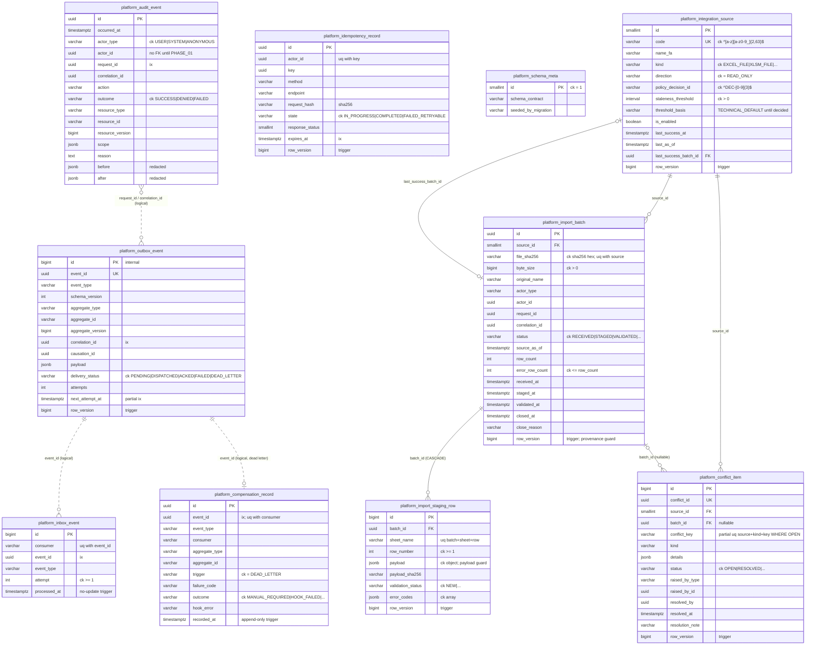

# ERD - platform tables (PHASE_00 migrations 0001-0006, PHASE_01 / 01.2 migrations 0007-0010)

Status: as of step 00.8 (code identical to commit `d6b6de96784d8d4d715e5978a2552c3531798faa` for the schema; no
migration was added after 00.6). Source of every column, constraint and index below: the schema dump of the
migration round-trip `reports/phase-00/step-7/logs/ci/migration/schema_up_1.sql` (diff against the re-applied
schema is empty: `reports/phase-00/step-7/logs/ci/migration/schema_diff.txt`). Conventions and rollback:
`docs/db/README.md`; integration behaviour: `docs/integration/README.md`.

PHASE_00 has no business tables, no user table and no 14-digit code column (code issuing is BLOCKED,
DEC-005 / DEC-008). `actor_id`, `raised_by_id`, `resolved_by` are UUIDs without FK; the FK to the user table
comes in PHASE_01.

## 1. Migration IDs (app `platform_core`)

| ID | Step | Kind | Content | Reverse |
|---|---|---|---|---|
| `0001_initial` | 00.2 | schema | `platform_audit_event`, `platform_outbox_event`, `platform_idempotency_record`, `platform_schema_meta` | drop the 4 tables |
| `0002_db_triggers` | 00.2 | `RunSQL` | append-only + no-truncate triggers on audit, `platform_touch_row` on outbox / idempotency | drop triggers + functions |
| `0003_seed_schema_meta` | 00.2 | seed | singleton row `platform_schema_meta(id=1)` | delete that row |
| `0004_integration` | 00.6 | schema | `platform_integration_source`, `platform_import_batch`, `platform_import_staging_row`, `platform_conflict_item`, `platform_inbox_event`, `platform_compensation_record` | drop the 6 tables |
| `0005_integration_triggers` | 00.6 | `RunSQL` | touch triggers (source, batch, staging row, conflict), `platform_import_batch_provenance_guard`, `platform_staging_row_payload_guard`, compensation append-only, inbox no-update | drop triggers + functions |
| `0006_seed_integration_sources` | 00.6 | seed | 3 READ-ONLY source rows (`rahkaran_excel` -> DEC-016, `legacy_planning_xlsm` / `legacy_wh_xlsm` -> DEC-025), thresholds TECHNICAL DEFAULT | delete the seeded rows only if they have no batches/conflicts |

Round-trip evidence (up -> zero -> up, schema diff empty): 00.2 `reports/phase-00/step-2/logs/schema/`, 00.6
`reports/phase-00/step-6/logs/migrations/`, 00.7 `reports/phase-00/step-7/logs/ci/05_migration.log`.

## 2. Diagram

Solid lines are real foreign keys (all `ON DELETE PROTECT` in Django, except staging rows: `CASCADE` from their
batch). Dotted lines are logical correlations (no FK).

## 3. Keys and indexes of the 00.6 tables (from the schema dump)

| Table | Unique | Indexes |
|---|---|---|
| `platform_integration_source` | `uq_integration_source_code (code)` | FK index on `last_success_batch_id` |
| `platform_import_batch` | `uq_import_batch_source_sha256 (source_id, file_sha256)` (idempotent receive) | `ix_import_batch_source_recv (source_id, received_at)`, `ix_import_batch_status (status, received_at)`, FK index |
| `platform_import_staging_row` | `uq_staging_row_position (batch_id, sheet_name, row_number)` | `ix_staging_row_batch_status (batch_id, validation_status)`, FK index |
| `platform_conflict_item` | `uq_conflict_item_conflict_id (conflict_id)`; partial `uq_conflict_item_open_key (source_id, kind, conflict_key) WHERE status = 'OPEN'` | `ix_conflict_item_batch`, `ix_conflict_item_status (status, id)`, FK indexes |
| `platform_inbox_event` | `uq_inbox_event_consumer_event (consumer, event_id)` (dedup) | `ix_inbox_event_event` |
| `platform_compensation_record` | `uq_compensation_record_consumer_event (consumer, event_id)` | `ix_compensation_record_event`, `ix_compensation_record_outcome (outcome, recorded_at)` |

Indexes of the 00.2 tables: `docs/db/README.md` section 5. Every CHECK is named `ck_<table>_<rule>` (test
`test_all_check_constraints_are_explicitly_named`). DB roles: `ops/db/grants.sql` (app role: audit and
compensation INSERT+SELECT only), `docs/ops/DB_ROLES.md`.

---

# PHASE_01 / 01.2 - Platform & Identity schema (migrations 0007-0010)

Status: implemented in step 01.2 (commit: PENDING, see `reports/phase-01/step-2/REPORT.md`). Source of truth for
columns: the models in `backend/platform_core/{identity,org,workflow,documents,params,jobs}/models.py` and the
round-trip schema dump `reports/phase-01/step-2/logs/migration/schema_up_1.sql`. Logical design:
`docs/discovery/DATA_TABLE.md` (PHASE_01), state machines `docs/discovery/STATE_TRANSITIONS.md` section 4.
Decisions reflected: DEC-003, DEC-032, DEC-043, DEC-048..DEC-054 (all APPROVED 2026-11-04).

Note on PHASE_00 actor columns: `platform_audit_event.actor_id`, outbox and idempotency `actor_id` stay UUIDs
**without** FK to `platform_user` (audit is evidence: it must stay writable/readable independently of identity
rows; users are never deleted, so the id always resolves). Proposal for 01.3: verify actor existence in the
unit of work instead of a FK.

## 4. Migration IDs (app `platform_core`)

| ID | Kind | Content | Reverse |
|---|---|---|---|
| `0007_phase01_platform_schema` | schema | 33 tables (below) + 5 audit columns (`session_id`, `network_zone`, `chain_seq` unique, `prev_hash`, `event_hash`; DB defaults so older INSERTs stay valid); named CHECK/UNIQUE/INDEX; generated column `role_assignment.self_assignment`. Hand edit: the GeneratedField is added after the FK fields it references | drop tables / columns |
| `0008_phase01_db_guards` | `RunSQL` | `btree_gist`; 5 exclusion constraints; row-version triggers; append-only and terminal-state triggers; invariant triggers; `platform_param_value()` / `platform_param_int()` | drop all of it incl. the extension |
| `0009_phase01_constraint_names` | `RunPython` | renames Django-generated FK / unique / `_like` names of the 33 tables to `fk_/uq_/ix_<table>__<cols>`; the original name is kept in the catalog comment | renames back from the comment (exact) |
| `0010_seed_phase01_catalogue` | seed | 43 permissions, 11 roles (ACTIVE, matrix 1.0), 111 grants (matrix v1.0, DEC-049); unit types (DEC-048); upload allow-list (DEC-053); 3 protected job types; 32 parameter definitions + PUBLISHED values (DEC-032/048..054); `platform_schema_meta` -> `PHASE_01.2` | deletes exactly the seed rows (refused by PROTECT FKs once used); restores `PHASE_00.2` |

No users, no org units, no network ranges, no secrets are seeded. Round trip (up -> zero -> up, partial rollback
to 0006, empty schema diff, no extension left): `reports/phase-01/step-2/logs/migration/`.

## 5. PHASE_01 tables

| Area | Table | PK | Key FKs | Unique / exclusion | State CHECK (values = OpenAPI 0.5.1 enums) |
|---|---|---|---|---|---|
| identity | `platform_user` | uuid | created_by/updated_by -> user | `uq_user_username`; partial `uq_user_single_break_glass` | status CREATED/ACTIVE/LOCKED/DISABLED; account_kind PERSON/OPERATOR |
| identity | `platform_credential` | user_id (1:1) | user, set_by | - | one-time password: expiry + must_change |
| identity | `platform_password_history` | bigint | user | - | append-only |
| identity | `platform_mfa_factor` | uuid | user, revoked_by | partial `uq_mfa_factor_one_active` (user, method), `uq_mfa_factor_one_pending` | method TOTP; status PENDING/ACTIVE/REVOKED |
| identity | `platform_recovery_code` | bigint | user | `uq_recovery_code_user_hash` | used_at set once |
| identity | `platform_session` | uuid (public handle) | user, revoked_by | `uq_session_key_hash` (SHA-256 of the cookie) | state MFA_PENDING/ACTIVE/EXPIRED/REVOKED/LOGGED_OUT; zone INTERNAL/EXTERNAL/UNKNOWN |
| identity | `platform_login_attempt` | bigint | user, session (nullable) | - | outcome list; append-only, delete only after 24 months |
| identity | `platform_permission` | action (varchar) | - | - | BA => maker_checker + MFA |
| identity | `platform_role` | uuid | created_by/updated_by | `uq_role_code` | status DRAFT/ACTIVE/RETIRED (only DRAFT->ACTIVE->RETIRED, REV-0105); kind TECHNICAL/BUSINESS |
| identity | `platform_role_permission` | bigint | role, permission_action | `uq_role_permission_pair` | grant_mode SCOPE/OWN/OWN_UNIT/OWN_AND_OWN_UNIT |
| identity | `platform_role_assignment` | uuid | user, role, scope_unit, approval_request, granted_by/revoked_by | `ex_role_assignment_no_overlap` (user, role, scope, period) for PENDING/ACTIVE | status PENDING_APPROVAL/ACTIVE/EXPIRED/REVOKED |
| identity | `platform_break_glass_usage` | uuid | user (break-glass only), session | - | closing columns once only |
| org | `platform_org_unit_type` | code | created_by | - | seeded COMPANY/DEPARTMENT/SECTION/LINE |
| org | `platform_org_unit` | uuid | unit_type_code, parent (self) | `uq_org_unit_code` | status ACTIVE/INACTIVE |
| org | `platform_org_unit_history` | bigint | unit, parent | `uq_org_unit_history_version`; `ex_org_unit_history_no_overlap` | written by trigger only |
| org | `platform_position` | uuid | unit, reports_to (self) | `uq_position_code`; partial `uq_position_one_active_head` | status ACTIVE/INACTIVE; `primary_capacity` >= 1, unit head = 1 (Q-0106) |
| org | `platform_position_history` | bigint | position, unit, reports_to | `uq_position_history_version`; `ex_position_history_no_overlap` | written by trigger only |
| org | `platform_position_assignment` | uuid | position, user | `ex_position_assignment_one_primary` (user, period, PRIMARY); `ex_position_assignment_no_duplicate` | kind PRIMARY/ACTING (ACTING needs valid_to) |
| workflow | `platform_workflow_definition` | uuid | - | `uq_workflow_definition_key_version`; partial `uq_workflow_definition_active` | DRAFT/ACTIVE/RETIRED; steps JSON array |
| workflow | `platform_workflow_instance` | uuid | definition (pinned), started_by, cancel_requested_by | - | RUNNING/WAITING/CANCEL_REQUESTED/COMPENSATING/COMPLETED/CANCELLED/FAILED |
| workflow | `platform_workflow_step_event` | bigint | instance, actor | `uq_workflow_step_event_seq` | append-only |
| workflow | `platform_approval_request` | uuid | action -> permission, requested_by, decided_by, route_scope_unit, workflow_instance | partial `uq_approval_request_one_pending` (resource, revision, action) | PENDING/APPROVED/REJECTED/WITHDRAWN/SUPERSEDED/EXPIRED; decided_by <> requested_by; expires_at NOT NULL |
| workflow | `platform_work_task` | uuid | assignee user/unit/position, workflow_instance, created/completed/closed/cancelled_by | - | OPEN/ASSIGNED/IN_PROGRESS/BLOCKED/DONE/CLOSED/CANCELLED; closed_by <> completed_by |
| documents | `platform_upload_type` | extension | - | - | never xlsm/docm/exe/scripts (CHECK) |
| documents | `platform_stored_object` | storage_key | - | - | encryption ENCRYPTED_VOLUME; purge markers once only |
| documents | `platform_document` | uuid | current_approved_revision, created_by/updated_by | - | sensitivity S1/S2/S3 |
| documents | `platform_document_revision` | uuid | document, parent_revision, storage_key (1:1), upload_extension, uploaded/submitted/decided_by, approval_request | `uq_document_revision_no`; partial `uq_document_revision_one_approved` | status WORKING/IN_REVIEW/APPROVED/REJECTED/SUPERSEDED; scan QUARANTINED/SCANNING/CLEAN/REJECTED |
| params | `platform_parameter_definition` | key | created_by | - | datatype list; classification TECHNICAL/OWNER_POLICY/BUSINESS_RULE |
| params | `platform_parameter_value` | uuid | parameter_key, proposed_by/published_by, approval_request | partial `uq_parameter_value_effective` (key, effective_from) for PUBLISHED/SUPERSEDED | DRAFT/PENDING_APPROVAL/PUBLISHED/SUPERSEDED/REJECTED |
| params | `platform_dynamic_field_definition` | uuid | created_by/updated_by | `uq_dynamic_field_key` | status DRAFT only |
| jobs | `platform_job_definition` | job_type | - | - | protected => not cancellable |
| jobs | `platform_job_run` | uuid | job_type, requested_by, cancel_requested_by | `uq_job_run_task_key`; partial `uq_job_run_worker_task_id` | QUEUED/RUNNING/CANCEL_REQUESTED/CANCELLED/SUCCEEDED/FAILED |
| jobs | `platform_audit_integrity_run` | uuid | job_run | - | OK/BROKEN/ERROR; append-only |

Every FK is `ON DELETE PROTECT` (Django) / `DEFERRABLE INITIALLY DEFERRED`, named `fk_<table>__<column>`, and has
an explicit `ix_` index. Every timestamp is `timestamptz` (UTC). Codes and keys are `varchar` (never numeric).

```mermaid
erDiagram
    platform_user ||--o| platform_credential : "1:1"
    platform_user ||--o{ platform_password_history : ""
    platform_user ||--o{ platform_mfa_factor : ""
    platform_user ||--o{ platform_recovery_code : ""
    platform_user ||--o{ platform_session : ""
    platform_user |o--o{ platform_login_attempt : "nullable"
    platform_user ||--o{ platform_break_glass_usage : "break-glass only"
    platform_role ||--o{ platform_role_permission : ""
    platform_permission ||--o{ platform_role_permission : ""
    platform_user ||--o{ platform_role_assignment : ""
    platform_role ||--o{ platform_role_assignment : ""
    platform_org_unit |o--o{ platform_role_assignment : "scope_unit"
    platform_approval_request |o--o{ platform_role_assignment : "DEC-032 second person"
    platform_org_unit_type ||--o{ platform_org_unit : ""
    platform_org_unit |o--o{ platform_org_unit : "parent"
    platform_org_unit ||--o{ platform_org_unit_history : "trigger"
    platform_org_unit ||--o{ platform_position : ""
    platform_position |o--o{ platform_position : "reports_to"
    platform_position ||--o{ platform_position_history : "trigger"
    platform_position ||--o{ platform_position_assignment : ""
    platform_user ||--o{ platform_position_assignment : ""
    platform_permission ||--o{ platform_approval_request : "action"
    platform_workflow_definition ||--o{ platform_workflow_instance : "pinned"
    platform_workflow_instance ||--o{ platform_workflow_step_event : ""
    platform_workflow_instance |o--o{ platform_work_task : ""
    platform_workflow_instance |o--o{ platform_approval_request : ""
    platform_document ||--o{ platform_document_revision : ""
    platform_document |o--o| platform_document_revision : "current_approved"
    platform_stored_object ||--|| platform_document_revision : "storage_key"
    platform_upload_type ||--o{ platform_document_revision : ""
    platform_parameter_definition ||--o{ platform_parameter_value : ""
    platform_job_definition ||--o{ platform_job_run : ""
    platform_job_run |o--o{ platform_audit_integrity_run : ""
```

## 6. PHASE_01 guards (migration 0008) and privileges (`ops/db/grants.sql`)

| Guard | Rule (decision) | Object |
|---|---|---|
| TECHNICAL role never holds a business-approval permission | DEC-003 | `trg_role_permission_guard`, `trg_role_kind_guard`, `trg_permission_ba_guard` (`ck_role_technical_no_business_approval`) |
| grants change only while the role is DRAFT | matrix versioning (DEC-049) | `trg_role_permission_guard` (`ck_role_permission_draft_only`) |
| role lifecycle DRAFT->ACTIVE->RETIRED only; RETIRED terminal and only without live assignments; kind/matrix_version frozen after DRAFT (closes the ACTIVE->DRAFT->add BA->ACTIVE bypass) | REV-0105, DEC-032 | `trg_role_kind_guard` (`ck_role_lifecycle`, `ck_role_retire_unassigned`), `trg_role_a_terminal`; the 0010 reverse disables the grant guard as schema owner only |
| OWNER_POLICY values proposed/published only by an ACTIVE `owner_admin` holder, with reason (no second person) | Q-0103 employer answer 2026-11-05 | `trg_parameter_value_guard` (`ck_parameter_value_owner_policy`), `platform_holds_owner_admin()` |
| at most `primary_capacity` PRIMARY holders per position at any instant (exact peak count, per-position advisory lock) | Q-0106 employer answer 2026-11-05 | `trg_position_assignment_guard`, `platform_position_peak_primary()` (`ck_position_primary_capacity`) |
| BA-role assignment needs an APPROVED request decided by a person other than grantor and assignee; the flag cannot be forced off | DEC-032 | `trg_role_assignment_guard` + `ck_role_assignment_second_approval` |
| console bootstrap only for TECHNICAL roles | DEC-049 item 4 | `ck_role_assignment_bootstrap_technical` |
| approval decided_by <> requested_by; one PENDING per (resource, revision, action); terminal immutable | DEC-032 | `ck_approval_request_maker_checker`, `uq_approval_request_one_pending`, `trg_approval_request_a_terminal` |
| document approver <> uploader; review only when CLEAN; content immutable; APPROVED -> SUPERSEDED only; size <= `document_upload_max_bytes`; type allowed; starts QUARANTINED | DEC-032, DEC-053, SEC-03 | `ck_document_revision_*`, `trg_document_revision_guard` |
| BUSINESS_RULE publisher <> proposer; typed/bounded values; published values immutable | DEC-032 | `trg_parameter_value_guard` |
| org tree acyclic, depth <= `org_tree_max_depth` (6), ACTIVE child needs ACTIVE parent, deactivate only empty units; serialised by an advisory lock | DEC-048 | `trg_org_unit_tree_guard` |
| reports-to between positions acyclic; one ACTIVE head per unit; deactivate only without holder | DEC-048 | `trg_position_guard`, `uq_position_one_active_head` |
| one PRIMARY position per person at any instant; ACTING needs an end date; no ADDITIONAL | DEC-048 | `ex_position_assignment_one_primary`, `ck_position_assignment_acting_has_end`, `ck_position_assignment_kind` |
| effective-dated history, never back-dated (`effective_from >= now - 60 s` technical clock tolerance) or future-dated | DEC-048 item 7, REV-0107 employer answer 2026-11-05 | `trg_org_unit_effective` / `trg_position_effective`, history writers (SECURITY DEFINER) |
| operator accounts internal-only; no shared/service/directory accounts | DEC-052, DEC-003 | `ck_user_operator_internal_only`, `ck_user_account_kind` |
| TOTP only, replay guard, revoked factor has no secret | DEC-050 | `ck_mfa_factor_*`, `trg_mfa_factor_guard` |
| one break-glass account; usage only for it; usage record append-only | DEC-054 | `uq_user_single_break_glass`, `trg_break_glass_usage_*` |
| login events never updated, deleted only after `retention_login_events_months` (24) | DEC-032 | `trg_login_attempt_guard` |
| protected/non-cancellable job types cannot be cancelled; terminal runs immutable | Gate-1, DEC-024 | `trg_job_run_guard`, `ck_job_definition_protected_not_cancellable` |
| synthetic rows must carry «محیط آزمایشی — داده ساختگی» | PHASE_01 forbidden scope | `ck_user_synthetic_label`, `ck_org_unit_synthetic_label`, `ck_position_synthetic_label` |

Privileges for the runtime (app) role, on top of the triggers: no UPDATE/DELETE on password history, workflow
step events, integrity runs; no UPDATE on login attempts; no INSERT/UPDATE/DELETE on the two history tables
(written by SECURITY DEFINER triggers); no DELETE on identity/role/assignment/org/workflow/document/job/parameter
rows; no INSERT/UPDATE/DELETE on the reviewed catalogues (permissions, upload types, job types, workflow
definitions); EXECUTE on the parameter functions, `platform_holds_owner_admin()` and
`platform_position_peak_primary()`. As before, the app role owns nothing, so it cannot
disable/drop triggers or constraints. Evidence: `reports/phase-01/step-2/logs/roles/roles_check.json`.
