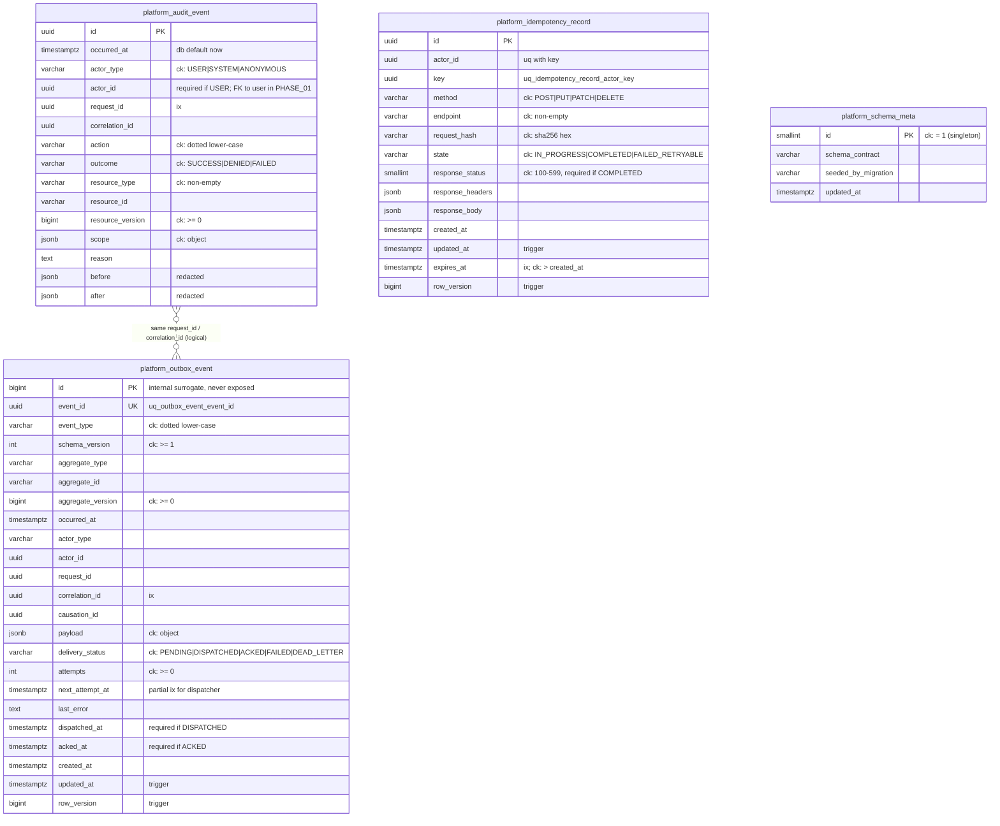

# Database - conventions, migrations, rollback (PHASE_00 / 00.2)

Stack: PostgreSQL 17 + Django 5.2 LTS migrations (DEC-001, ADR-001). Code: `backend/` (Django project
`aleekhan`, app `platform_core`). Only PostgreSQL is supported; there is no SQLite fallback, because the
schema relies on triggers, regex CHECK constraints and partial indexes.

PHASE_00 scope: platform skeleton tables only. No business tables, no users/roles (PHASE_01), no real data.

## 1. Conventions (all modules, all phases)

| Topic | Rule |
|---|---|
| Table names | `<module>_<entity>` in snake_case, set explicitly with `Meta.db_table` (e.g. `platform_outbox_event`). |
| Primary keys | UUID (`uuid4`) for anything that may be exposed. A `bigint` identity is allowed only as an internal surrogate that is never exposed (e.g. `platform_outbox_event.id`; the public identity is `event_id`). Business codes are never PKs. |
| Constraint names | Explicit and prefixed: `ck_<table>_<rule>` (CHECK), `uq_<table>_<cols>` (UNIQUE), `ix_<table>_<purpose>` (index), `fk_<table>_<ref>` (FK, from PHASE_01), `trg_<table>_<purpose>` (trigger). Test `test_all_check_constraints_are_explicitly_named` fails on any unnamed CHECK. Do not use `PositiveIntegerField` & co.: they create unnamed CHECKs; use a plain integer field + a named `ck_` constraint. |
| Enumerations | `varchar` + `TextChoices` + a named CHECK listing the allowed values (no PostgreSQL ENUM types: they are hard to change in a reversible migration). |
| Time | `timestamptz`, stored in UTC (`USE_TZ=True`, `TIME_ZONE="UTC"`). Server-side defaults use `db_default=Now()` (= `STATEMENT_TIMESTAMP()`); triggers use `statement_timestamp()` too. Jalali / Asia/Tehran is display only. |
| Concurrency | Mutable rows carry `row_version bigint` (start 1, CHECK >= 1). A `BEFORE UPDATE` trigger (`platform_touch_row`) sets `row_version = OLD.row_version + 1`, `updated_at = statement_timestamp()` and keeps `created_at`; a client-supplied `row_version` is ignored. Writers use `UPDATE ... WHERE row_version = <If-Match>` and re-read the row. |
| Immutable rows | Audit (and later ledgers) are append-only: a trigger raises SQLSTATE `23001` (restrict_violation -> `django.db.IntegrityError`) on UPDATE/DELETE, and on TRUNCATE of a non-empty table. Corrections are new compensating rows. |
| JSON | `jsonb`; payload-like columns have a CHECK `jsonb_typeof(col) = 'object'`. No salary, password or PII in audit `before/after` or outbox payloads (redaction is enforced by the writer, step 00.3 / 00.7). |
| 14-digit codes | `platform_core.code14`: `Code14Field` = `varchar(14)` + validator (exactly 14 ASCII digits, string, leading zeros kept; ints and Persian/Arabic-Indic digits are rejected, not converted) + `code14_check_constraint(field, name)` = `CHECK (col ~ '^[0-9]{14}$')`. Every code column must also carry its namespace (`product_code` vs `die_code`). Format only; issuing codes is BLOCKED (DEC-005 / DEC-008). No table uses it yet. |
| Actors | `actor_type` (`USER`/`SYSTEM`/`ANONYMOUS`) + `actor_id uuid`; CHECK: a `USER` actor must have an `actor_id`. The FK to the user table is added in PHASE_01. |
| Audit columns | Owned business tables carry `created_at`, `created_by`, `updated_at`, `updated_by`, `row_version` (DATA_TABLE.md). **Exemption for platform system tables (REV-0007):** `platform_audit_event`, `platform_outbox_event` and `platform_idempotency_record` record who acted in `actor_type`/`actor_id`, which serves as `created_by`; they have no `updated_by` because only the engine (system) updates them (outbox delivery state, idempotency state), and the audit table is never updated. `platform_audit_event` has no `row_version` (append-only, never updated). `platform_schema_meta` is a non-sensitive singleton written only by migrations and is exempt from `created_*`, `updated_by` and `row_version`. |
| Money / quantity | `numeric(p,s)` + UOM, never float (from PHASE_02 on). |
| Config | DB connection only from env (`DATABASE_URL` or `PG*`), see `backend/.env.example`. No credentials in Git. |

## 2. Migration IDs (app `platform_core`)

| ID | Kind | Content | Reverse |
|---|---|---|---|
| `platform_core.0001_initial` | schema (generated) | tables `platform_audit_event`, `platform_outbox_event`, `platform_idempotency_record`, `platform_schema_meta`; PK/UNIQUE/CHECK/indexes | drops the 4 tables |
| `platform_core.0002_db_triggers` | `RunSQL` | functions `platform_reject_mutation`, `platform_reject_truncate_nonempty`, `platform_touch_row`; triggers `trg_audit_event_append_only`, `trg_audit_event_no_truncate`, `trg_outbox_event_touch`, `trg_idempotency_record_touch` | drops the triggers and functions |
| `platform_core.0003_seed_schema_meta` | `RunPython` (seed) | one non-sensitive row in `platform_schema_meta`: `id=1, schema_contract='PHASE_00.2', seeded_by_migration='platform_core.0003_seed_schema_meta'` | deletes that row only |

The seed is the only data written by migrations. It is not audited: writing an audit row from a migration
would make the migration irreversible (audit rows cannot be deleted).

## 3. Commands

Environment: export `PG*` (or `DATABASE_URL`) first, e.g. `set -a; . backend/.env; set +a`.
Python: `.venv/Scripts/python` (Windows) or `.venv/bin/python` (Linux); `pip install -r backend/requirements-dev.txt`.

```
cd backend
python manage.py migrate                         # up to latest
python manage.py showmigrations platform_core    # applied IDs
python manage.py makemigrations --check --dry-run  # model/migration drift (must print "No changes detected")
python manage.py sqlmigrate platform_core 0001   # review SQL of a migration
pytest                                           # creates a throw-away test DB (needs CREATEDB)
```

Round-trip + schema-diff evidence (creates and drops a throw-away database `aleekhan_roundtrip`):

```
PG_BIN=<dir of psql/pg_dump> PYTHON=<venv python> backend/scripts/db_roundtrip.sh <output-dir>
```

It runs: up from empty DB -> `makemigrations --check` -> `pg_dump --schema-only` (A) -> `migrate platform_core zero`
(asserts only `django_migrations` remains and no `platform_*` function is left) -> up again -> dump (B) ->
`diff A B` must be empty. pg_dump >= 17.6 writes a random `\restrict` token; the script strips it.

## 4. Rollback instructions

Rollback = apply the reverse of each migration, newest first:

```
python manage.py migrate platform_core 0002   # remove the seed row only
python manage.py migrate platform_core 0001   # remove triggers/functions (audit no longer protected!)
python manage.py migrate platform_core zero   # DROP all platform tables
```

Rules:
1. Take a backup first (`pg_dump -Fc`) and record the migration ID you roll back from/to in the release report.
2. Rolling back below `0002` removes the append-only protection; below `0001` drops the tables and **all audit
   and outbox data**. On staging/production this is only allowed with an approved compensation plan
   (PHASE_00 Gate: "Migration reversible or approved compensation plan"); prefer a forward fix migration.
3. Migrations that hold data in later phases must ship a tested reverse or be marked irreversible with a
   written compensation plan in the step report.
4. Evidence for this step: `reports/phase-00/step-2/logs/db_roundtrip.log` and `logs/schema/`.

## 5. ERD (PHASE_00 platform tables)

No foreign keys exist yet: the only natural reference (`actor_id` -> user) targets a PHASE_01 table.
Relations below are logical (correlation by ids), not FKs.



Indexes: `ix_audit_event_occurred`, `ix_audit_event_resource (resource_type, resource_id, occurred_at)`,
`ix_audit_event_actor (actor_id, occurred_at)`, `ix_audit_event_request`; `ix_outbox_event_dispatch
(next_attempt_at, id) WHERE delivery_status IN ('PENDING','FAILED')`, `ix_outbox_event_dead_letter (occurred_at)
WHERE delivery_status = 'DEAD_LETTER'`, `ix_outbox_event_aggregate`, `ix_outbox_event_correlation`;
`ix_idempotency_record_expires`.

## 6. Known limits (to be handled in later steps)

- The triggers protect against application bugs, not against the table owner (an owner can `DISABLE TRIGGER`).
  Separate DB roles (migration owner vs runtime role without UPDATE/DELETE/TRUNCATE on the audit table) and an
  audit integrity check (hash chain or periodic digest) belong to step 00.7.
- TRUNCATE of an *empty* audit table is allowed (needed for test-database flushes); it cannot destroy data.
- Behaviour (outbox dispatch/backoff, idempotency protocol, retention window, redaction) is implemented in step
  00.3 without schema changes: see `docs/engine/README.md`. No migration was added in 00.3.
